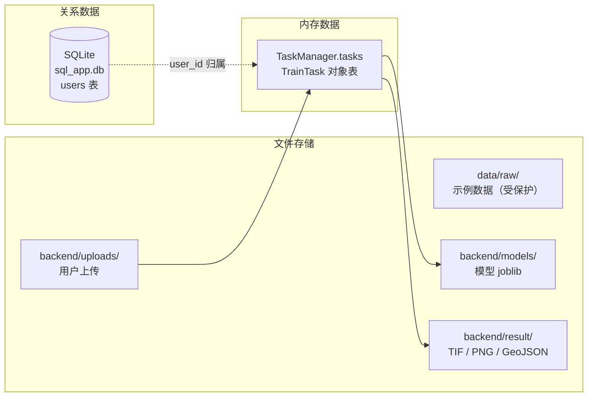

# 滑坡易发性评价 WebGIS 平台 —— 数据库与数据结构设计

| 项目名称 | 滑坡易发性评价 WebGIS 平台 |
|---|---|
| 文档编号 | LS-WGIS-DB-001 |
| 版本 | V1.2 |
| 编写日期 | 2026-11-16（V1.0）；2026-11-18 修订至 V1.2（V1.1 功能同步、V1.2 并发承载） |
| 文档状态 | 正式发布 |
| 实现依据 | `backend/database.py`、`db_models.py`、`config.py`、`train_task.py`、`gis_preprocess.py`、`result_export.py` |

---

## 1 引言

### 1.1 编写目的

本文档定义滑坡易发性评价 WebGIS 平台的数据存储体系：SQLite 关系数据、文件存储布局、内存数据结构、GIS 数据规格与结果 JSON 结构，作为数据层实现、测试与运维的依据。

### 1.2 设计原则

1. **轻量化**：单机部署，关系数据仅存用户账号，其余以文件 + 内存为主，不引入大型数据库；
2. **隔离性**：上传文件按用户分目录，任务记录归属人，支撑接口层数据隔离；
3. **可追溯**：训练产物按 task_id 命名，任务与产物一一对应、可整体清理；
4. **安全**：示例数据受保护不可删，删除操作目录白名单校验，口令哈希存储。

### 1.3 存储体系总览

| 存储层 | 载体 | 存储内容 | 持久性 |
|---|---|---|---|
| 关系数据 | SQLite（`backend/sql_app.db`） | 用户账号 | 持久 |
| 文件存储 | 本地磁盘目录 | 上传数据、模型、训练结果、示例数据 | 持久 |
| 内存数据 | Python 对象（`task_manager`） | 训练任务状态、进度、指标、结果包 | 进程级（重启丢失） |
| 配置数据 | `.env` 环境变量 | JWT 密钥、管理员初始账号、CORS | 持久（部署配置） |



---

## 2 SQLite 数据库设计

### 2.1 连接配置（database.py）

| 项 | 设计 |
|---|---|
| 引擎 | SQLAlchemy `create_engine` |
| 连接串 | `sqlite:///backend/sql_app.db`（BASE_DIR 拼接，与 main.py 同级） |
| 连接参数 | `check_same_thread=False`（FastAPI 多线程共享连接）、`timeout=5`（busy_timeout=5s，并发写等待而非立刻报锁） |
| 日志模式 | **WAL**（`PRAGMA journal_mode=WAL`，连接时经 SQLAlchemy event 启用）：读写不互斥，登录/查询突发并发下不再锁库（V1.2 新增） |
| 会话 | `sessionmaker(autocommit=False, autoflush=False)` |
| 会话依赖 | `get_db()`：yield 会话，finally close（FastAPI Depends 注入） |
| ORM 基类 | `declarative_base()` → `Base` |

### 2.2 users 表设计

表名：`users`（SQLAlchemy 模型 `db_models.User`）

| 列名 | 类型 | 约束 | 说明 |
|---|---|---|---|
| id | INTEGER | PRIMARY KEY, 自增 | 用户 ID（任务/文件归属标识） |
| username | VARCHAR | UNIQUE, NOT NULL, INDEX | 登录用户名 |
| password_hash | VARCHAR | NOT NULL | bcrypt 口令哈希（passlib） |
| role | VARCHAR | NOT NULL, 默认 'user' | 角色：admin / user |
| is_active | BOOLEAN | NOT NULL, 默认 true | 账号启用状态（false 登录拒绝） |
| created_at | DATETIME | 默认 utcnow | 创建时间 |

DDL（等价示意）：

```sql
CREATE TABLE users (
    id          INTEGER PRIMARY KEY AUTOINCREMENT,
    username    VARCHAR NOT NULL UNIQUE,
    password_hash VARCHAR NOT NULL,
    role        VARCHAR NOT NULL DEFAULT 'user',
    is_active   BOOLEAN NOT NULL DEFAULT 1,
    created_at  DATETIME DEFAULT CURRENT_TIMESTAMP
);
CREATE UNIQUE INDEX ix_users_username ON users (username);
```

### 2.3 数据初始化（main.on_startup）

服务启动时执行：

1. `Base.metadata.create_all(bind=engine)` —— 自动建表（幂等）；
2. 初始化管理员：按 `ADMIN_USERNAME`（默认 admin）查询，不存在则插入一条 role=admin 的记录，口令为 `ADMIN_PASSWORD`（.env 配置，bcrypt 哈希入库），并打印初始化成功日志。

> 管理员口令仅在首次创建时写入；已存在时不覆盖，改密需另行处理。

### 2.4 数据访问模式

| 场景 | 操作 | 位置 |
|---|---|---|
| 登录 | `query(User).filter(username)` + `verify_password` | routers/auth.py |
| 令牌校验 | `query(User).filter(id)` + `is_active` 检查 | security.get_current_user |
| 数据隔离 | 任务/文件按 `user.id` 比对，admin 放行 | main.py 各接口 |

用户量级小（个位数），无分库分表、无冗余索引需求。

---

## 3 文件存储设计

### 3.1 目录布局

```
landslide-webgis-platform/
├── data/raw/                    ← 内置示例数据（受保护，API 不可删）
│   ├── DEM.tif / Slope.tif / aspect.tif / plan_cur.tif / curvature.tif / NDVI.tif
│   ├── （另有 LandCover/NDWI/MNDWI/NDBI/lithology/precip 等完整因子库）
│   ├── disaster-site/ + disaster-site.zip    ← 96 个滑坡灾害点
│   └── researcharea/ + researcharea.zip      ← 研究区边界
└── backend/
    ├── uploads/                 ← 用户上传（删除接口允许范围）
    │   └── {user_id}/{uuid}/    ← 按用户 + 批次隔离
    │       ├── DEM.tif ...
    │       └── disaster-site/   ← 上传的 shp 全套及边车文件
    │   └── {user_id}/models/    ← 用户上传的自定义模型（.joblib/.pkl）
    ├── models/                  ← 训练模型
    │   └── {model_type}_model.joblib
    ├── result/                  ← 训练与渲染产物（/static 挂载点）
    │   ├── landslide_susceptibility_{task_id}.tif
    │   ├── susceptibility_{task_id}.png
    │   ├── points_{task_id}.geojson
    │   ├── study_area_{task_id}.geojson
    │   └── factor_{md5}.png
    └── sql_app.db               ← SQLite
```

### 3.2 文件命名规则

| 产物 | 命名模式 | 说明 |
|---|---|---|
| 上传批次目录 | `uploads/{user_id}/{uuid4}/` | 按用户 + 批次隔离，uuid 防冲突 |
| 任务结果 TIF | `landslide_susceptibility_{task_id}.tif` | 按任务独立，避免并发覆盖 |
| 中间栅格 | `landslide_susceptibility_{uuid8}.tif` | 训练流程内部输出，uuid 防并发训练互相覆盖（V1.2） |
| 风险渲染 PNG | `susceptibility_{task_id}.png` | WGS84 渐变渲染图 |
| 矢量导出 | `points_{task_id}.geojson`、`study_area_{task_id}.geojson` | WGS84 GeoJSON |
| 因子叠加 PNG | `factor_{md5(绝对路径)[:10]}.png` | 内容摘要防同名冲突 |
| 模型文件 | `{model_type}_model.joblib` | randomforest / logistic / svm 等；`joblib.dump` 加模块级锁，防并发训练同名写坏 |
| 上传自定义模型 | `uploads/{user_id}/models/{原文件名}` | 文件名经 basename 清洗防穿越 |

> 中间产物 `result/landslide_susceptibility_{uuid8}.tif` 为训练流程原始输出（V1.2 起带 uuid 防并发覆盖），随后复制为任务独立文件 `landslide_susceptibility_{task_id}.tif`。

### 3.3 文件生命周期

| 阶段 | 上传文件 (uploads) | 模型 (models) | 结果 (result) |
|---|---|---|---|
| 上传 | 写入 | — | — |
| 训练 | 只读 | 写入 joblib | 写入 TIF/PNG/GeoJSON |
| 成果下载 | — | — | 经 /static 读取 |
| 删除任务 | — | 保留（按 model_type 复用） | 按 task_id 全量清理 |
| 删除文件 | 删文件/目录 + shp 边车级联 | — | — |

### 3.4 保护与安全机制

1. **示例数据保护**：删除接口 `_ensure_within` 将目标限定在 `backend/uploads/` 内，`data/raw` 无法通过 API 删除；
2. **用户隔离**：非 admin 仅能删除 `uploads/{user_id}/` 内文件（realpath + commonpath 校验，防 `..` 路径穿越）；
3. **shp 边车级联**：删 .shp 时同步清理 .shx/.dbf/.prj/.cpg/.sbn/.sbx/.qpj/.shp.xml；
4. **上传文件名清洗**：取 `basename`，防止上传路径穿越。

---

## 4 内存数据结构设计

### 4.1 TrainTask（train_task.py，dataclass）

| 字段 | 类型 | 说明 |
|---|---|---|
| task_id | str | uuid4 任务唯一标识 |
| status | str | waiting / running / finished / failed |
| progress | float | 0~100 |
| msg | str | 阶段文案 / 错误信息 |
| user_id | int | 发起人（0=匿名/默认） |
| params | dict | 前端超参数（neg_ratio/n_estimators/lr_C/svm_C/svm_kernel），训练线程按命名参数传入 run_model_train |
| result_raster_path | str | 任务独立结果 TIF 路径 |
| metrics | Dict[str, float] | 评估指标 + feature_importances，见 5.3 |
| result_bundle | Dict | 结果包，见 7.1 |

### 4.2 TaskManager

| 项 | 设计 |
|---|---|
| 存储 | `tasks: Dict[str, TrainTask]`（内存字典） |
| 单例 | 模块级 `task_manager`，全请求共享 |
| create_task | 生成 uuid4，初始 waiting/progress=0 |
| get_task_info | 字典投影为 API 响应（不存在 → status=not_found） |
| list_tasks | 摘要列表（task_id/user_id/status/progress/msg/metrics） |
| remove_task | waiting/running 抛 RuntimeError；否则 pop |

**持久性说明**：任务表为进程内存态，服务重启后历史任务不可见（演示场景可接受，见概要设计约束）；落盘的 TIF/PNG/GeoJSON 不受影响，但失去任务上下文索引。

### 4.3 任务状态机取值

| status | 含义 | 可删除 |
|---|---|---|
| waiting | 已创建，线程未开跑 | 是 |
| running | 训练/渲染中 | 否（409） |
| finished | 成功，result_bundle 就绪 | 是 |
| failed | 异常终止，msg 含错误 | 是 |

---

## 5 训练数据集结构

### 5.1 特征矩阵

| 项 | 设计 |
|---|---|
| X | `np.ndarray (N, F)`，float32；N=样本数，F=因子数；列序 = factor_files 顺序 |
| y | `np.ndarray (N,)`，int32；1=滑坡正样本，0=非滑坡负样本 |
| 行含义 | 每行 = 一个像元位置在全部因子上的取值向量 |

### 5.2 采样参数（默认值）

| 参数 | 默认 | 含义 |
|---|---|---|
| neg_ratio | 3.0 | 负:正样本数比例 |
| min_dist_pixels | 3 | 负样本距正样本最小像元距离 |
| test_size | 0.3 | 验证集比例（分层抽样） |
| random_state | 42 | 随机种子（可复现） |

### 5.3 指标结构（metrics）

```json
{
  "AUC": 0.9132,
  "Accuracy": 0.8521,
  "Precision": 0.8103,
  "Recall": 0.7945,
  "F1": 0.8023,
  "feature_importances": { "DEM": 0.4121, "Slope": 0.2712, "aspect": 0.1123, "plan_cur": 0.0831, "curvature": 0.0698, "NDVI": 0.0515 }
}
```

AUC~F1 均为验证集上计算，round 4 位小数；feature_importances 为因子贡献度降序字典（RF 取 feature_importances_，线性模型取 |coef_| 归一化，其余 0 占位）。随 TrainTask 持有并经 API 返回。

---

## 6 GIS 数据规格

### 6.1 输入数据

| 数据 | 格式 | 必需属性 | 规格要求 |
|---|---|---|---|
| 因子栅格 | GeoTIFF（.tif） | CRS 投影、transform | 单波段；全部因子 shape/transform/crs 完全一致；nodata 声明可选（读取后统一置 NaN） |
| 灾害点 | Shapefile（.shp/.shx/.dbf/.prj 全套） | .prj（CRS） | Point 几何（非 Point 取 centroid）；点须落在研究区/因子有效范围内 |
| 研究区 | Shapefile（.shp/.shx/.dbf/.prj 全套） | .prj（CRS） | Polygon/MultiPolygon；限定采样与预测范围 |

### 6.2 输出数据

| 输出 | 格式 | 规格 |
|---|---|---|
| 易发性栅格 | GeoTIFF | float32 单波段，值域 0~1，nodata=NaN；沿用参考因子 profile（同投影/分辨率/范围） |
| 模型 | joblib | sklearn 估计器：RF / StandardScaler→LR Pipeline / 自定义 Pipeline / 上传模型原样保存 |
| 风险渲染图 | PNG (RGBA) | 重投影至 WGS84，NaN 透明，最大宽度 1600 |
| 矢量导出 | GeoJSON | 显式 to_crs(EPSG:4326) |

### 6.3 风险分级数据（常量定义）

| key | name | 值域 | color |
|---|---|---|---|
| very_low | 极低易发 | 0.0~0.2 | #2c7bb6 |
| low | 低易发 | 0.2~0.4 | #7fcdbb |
| moderate | 中易发 | 0.4~0.6 | #ffffb2 |
| high | 高易发 | 0.6~0.8 | #fdae61 |
| very_high | 极高易发 | 0.8~1.0 | #d7191c |

分级阈值 `BREAKS=[0.2, 0.4, 0.6, 0.8]` 固定不变，保证分级范围稳定；每级配防护建议文案（RISK_ADVICE）。

---

## 7 结果包数据结构（result_bundle）

训练完成时由 `build_web_bundle` 生成，随 TrainTask 持有，经 `/api/train/status`、`/api/result/raster` 返回。

### 7.1 结构总览

```json
{
  "overlay":   { "png_url", "tif_url", "bounds", "size", "crs", "source_shape", "pixel_size", "legend", "class_stats", "value_stats" },
  "vectors":   { "points": {"url", "count"}, "study_area": {"url", "count"} },
  "spatial_check": { "checks": [] }
}
```

### 7.2 overlay 字段

| 字段 | 类型 | 说明 |
|---|---|---|
| png_url / tif_url | string | /static/ 地址 |
| bounds | {west, south, east, north} | WGS84 边界（7 位小数），ImageOverlay 贴图定位 |
| size | {width, height} | PNG 像素尺寸 |
| crs / source_shape / pixel_size | — | 原投影栅格元信息 |
| legend | {breaks, classes, gradient} | 分级阈值、5 级配色、连续渐变锚点 |
| class_stats | array | 各级 {key,name,min,max,color,count,percent}，percent 为面积占比 |
| value_stats | {min, max, mean, total_pixels} | 有效像元统计 |

### 7.3 设计要点

1. `bounds` 与 PNG 行列线性对应（WGS84 等经纬重投影），保证与 GeoJSON 矢量严格套合；
2. `class_stats` 基于**原始投影栅格**统计，避免重采样偏差；
3. `legend.classes` 与点查询返回分级字段同源（同套 CLASSES 常量）。

---

## 8 配置数据设计（.env）

| 变量 | 必填 | 默认 | 说明 |
|---|---|---|---|
| JWT_SECRET | 是 | —（缺失启动报错） | 令牌签名密钥 |
| JWT_ALGORITHM | 否 | HS256 | 签名算法 |
| ACCESS_TOKEN_EXPIRE_MINUTES | 否 | 480 | 令牌有效期（分钟） |
| ADMIN_USERNAME | 否 | admin | 初始管理员用户名 |
| ADMIN_PASSWORD | 否 | admin123456 | 初始管理员密码（仅首次建号使用） |
| CORS_ORIGINS | 否 | http://localhost:5173 | 跨域白名单（逗号分隔） |
| SIGN_SECRET | 否 | 同 JWT_SECRET | 预留签名密钥 |

> 敏感配置不入库、不入代码；部署时经 `.env` 注入（python-dotenv 加载）。

---

## 9 数据完整性与一致性设计

| 保障点 | 措施 |
|---|---|
| 账号唯一 | username 唯一索引 + 应用层查重（管理员初始化幂等） |
| 任务与产物一致 | 产物命名嵌 task_id，删除任务按文件名匹配全量清理 |
| 训练可复现 | 固定 random_state=42，采样与划分确定性 |
| 特征-标签对齐 | 同一 (row,col) 在全部因子取值，列序与 factor_files 一致 |
| 并发任务隔离 | 每任务独立 TIF 副本（task_id 后缀），互不覆盖；中间栅格 uuid 命名、模型落盘加进程内锁（V1.2） |
| 并发读写 | SQLite WAL 模式 + busy_timeout=5s，突发并发登录/查询不锁库（V1.2） |
| 文件引用一致 | 上传返回绝对路径，训练/校验接口原样使用，不做二次解析 |
| 删除原子性 | 先删任务记录再清产物；产物清理逐文件 try/except，单文件失败不中断 |

---

## 10 数据量与性能参考

| 数据 | 典型规模（示例数据） |
|---|---|
| users 表 | 个位数行 |
| 因子栅格 | 6 个 × 620×780 像元量级（float32） |
| 训练样本 | 正样本 ≈ 96 + 负样本 ≈ 288（3:1） |
| 全区预测 | 掩膜内像元批量 predict_proba，秒级 |
| 结果产物 | 每任务 TIF + PNG + 2×GeoJSON，MB 级 |
| 任务表 | 内存字典，单机演示无压力 |

---

*文档结束*
