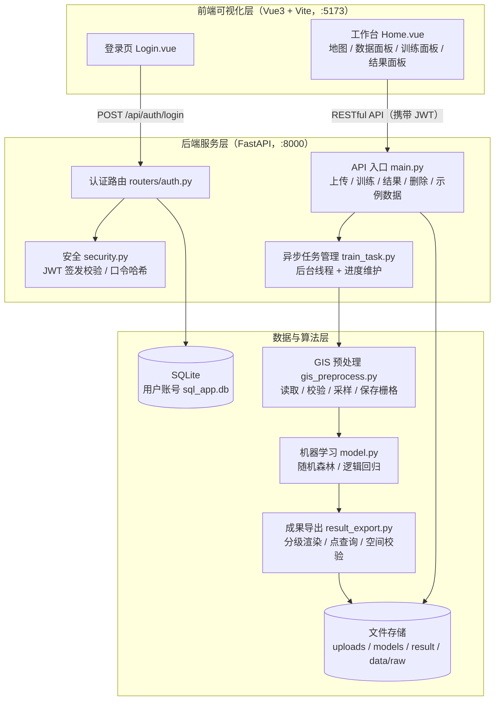
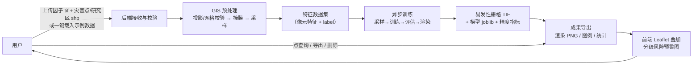
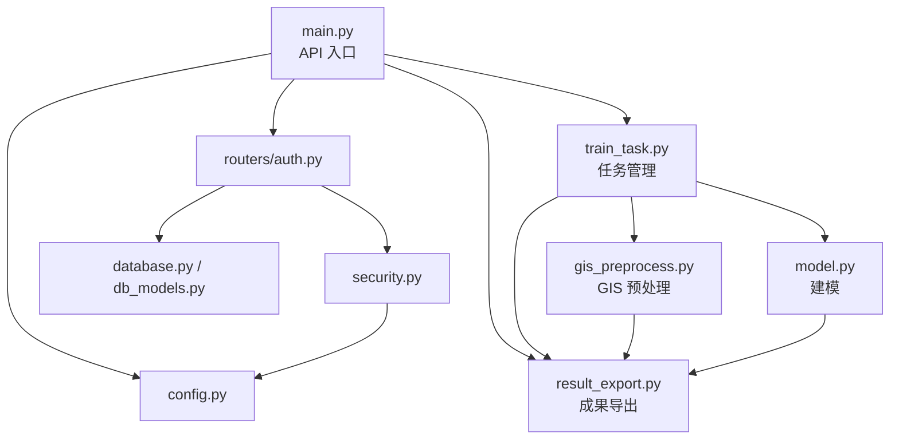

# 滑坡易发性评价 WebGIS 平台 —— 系统概要设计说明书

| 项目名称 | 滑坡易发性评价 WebGIS 平台 |
|---|---|
| 文档编号 | LS-WGIS-HLD-001 |
| 版本 | V1.2 |
| 编写日期 | 2026-11-16（V1.0）；2026-11-18 修订至 V1.2（V1.1 功能同步、V1.2 并发承载） |
| 文档状态 | 正式发布 |
| 输入依据 | 《需求分析说明书》（LS-WGIS-REQ-001） |

---

## 1 引言

### 1.1 编写目的

本文档从系统全局视角给出滑坡易发性评价 WebGIS 平台的总体架构、技术栈选型、模块划分、数据架构、接口概要、部署架构与出错处理设计，作为详细设计、编码实现与测试的上层依据。

预期读者：项目开发人员、测试人员、课程指导教师及项目评审人员。

### 1.2 设计目标

1. 采用前后端分离架构，模块解耦，便于独立开发调试；
2. 实现 GIS 空间数据解析、机器学习异步训练、滑坡风险动态可视化渲染三大核心能力；
3. 保证空间数据投影统一、网格对齐、空间采样逻辑正确；
4. 接口标准化（RESTful），方便前后端联调；
5. 系统轻量化，可在单机本地一键部署演示。

### 1.3 设计范围

本设计覆盖前端 WebGIS 可视化模块、后端 API 服务、异步任务调度、GIS 预处理模块、机器学习建模模块、用户认证模块与文件/成果管理模块，并包含最小并发承载设计（训练并发闸门 + 排队、SQLite WAL、GZip/静态缓存）。不含多租户权限体系、生产级大规模并发架构（多 worker/Redis/Celery）、深度学习建模。

### 1.4 参考资料

1. 《滑坡易发性评价 WebGIS 平台 需求分析说明书》
2. 《滑坡易发性评价 WebGIS 平台 系统详细设计说明书》
3. 《滑坡易发性评价 WebGIS 平台 API 接口设计文档》
4. 《滑坡易发性评价 WebGIS 平台 数据库与数据结构设计》
5. 项目根目录 `readme.md`

---

## 2 系统总体架构

### 2.1 架构风格

采用**三层架构：前端可视化层 — 后端服务层 — 数据与算法层**，前后端分离部署，通过 RESTful API + 文件静态服务进行数据交换。

### 2.2 各层职责

1. **前端可视化层**
   Vue3 + Vite + Element Plus + Leaflet。负责页面交互、地图展示、图层渲染、训练进度展示、结果可视化、参数配置与成果导出。通过 Axios 调用后端 RESTful API，轮询异步任务状态；路由守卫实现登录控制。
2. **后端服务层**
   FastAPI 作为 Web 服务框架，提供认证、文件上传、任务创建、进度查询、结果获取、点查询、删除等接口；使用后台线程实现**异步训练任务**，避免长时间模型训练阻塞 HTTP 请求；统一处理文件校验、异常捕获与日志输出。
3. **数据与算法层**
   - GIS 预处理模块：读取 tif 栅格、shp 矢量，投影与网格对齐校验、有效区掩膜、正负样本采样、特征提取、易发性栅格保存；
   - 机器学习模块：基于 Scikit-learn 构建评价模型（随机森林 / 逻辑回归），训练、评估（AUC 等）、全区预测、模型保存；
   - 成果导出模块：栅格重投影、分级着色渲染、点查询、矢量导出、空间逻辑校验；
   - 数据存储：本地文件存储（上传数据、模型、结果）+ SQLite（用户账号），不引入大型数据库，简化工程。

### 2.3 数据流转

用户上传 GIS 因子 + 滑坡样本（或载入示例数据）→ 后端 GIS 预处理 → 生成特征数据集 → 启动异步模型训练 → 模型输出易发性栅格 → 成果导出模块生成渲染数据 → 前端 Leaflet 加载栅格图层，动态分级渲染预警图，并支持点查询、PNG/TIF 导出。

### 2.4 部署架构

**主模式：前后端分离部署**

| 服务 | 技术 | 地址 | 说明 |
|---|---|---|---|
| 前端开发服务器 | Vite | http://127.0.0.1:5173 | `npm run dev`，热更新；`/api`、`/static` 代理到后端 |
| 后端 API 服务 | Uvicorn + FastAPI | http://127.0.0.1:8000 | API 服务 + 静态文件服务（结果渲染产物） |

前端通过 `vite.config.js` 的 `server.proxy` 将 `/api`、`/static` 转发到 8000 端口，浏览器侧无跨域问题。一键启动脚本 `start.bat` 同时拉起两个服务窗口。

**备选模式：单服务部署**

前端 `npm run build` 产出 `frontend/dist`，由后端以 `StaticFiles` 挂载到 `/` 直接托管，仅需 8000 端口。适用于演示环境简化部署。

---

## 3 技术栈选型

### 3.1 技术栈总览

| 层次 | 技术 | 版本要求 | 选型理由 |
|---|---|---|---|
| 前端框架 | Vue3 + Vite | Node.js 18+ | 组合式 API 开发效率高，Vite 启动快、热更新好 |
| UI 组件库 | Element Plus | — | 表单、弹窗、消息、进度条等组件齐全，风格统一 |
| 地图引擎 | Leaflet | — | 轻量级 WebGIS 库，ImageOverlay 叠加栅格渲染图简便，学习成本低 |
| 后端框架 | FastAPI | Python 3.10+ | 异步友好、自动 OpenAPI 文档、Pydantic 参数校验 |
| GIS 处理 | Rasterio / GDAL、GeoPandas、Shapely | — | 栅格读写与重投影、矢量处理的 Python 事实标准 |
| 机器学习 | Scikit-learn、NumPy、Pandas | — | 随机森林/逻辑回归等经典模型开箱即用，指标完善 |
| 模型持久化 | joblib | — | sklearn 模型序列化标准工具 |
| 认证 | PyJWT + Passlib(bcrypt) | — | 令牌鉴权 + 口令哈希，轻量且成熟 |
| 数据库 | SQLite + SQLAlchemy | — | 单机部署零运维，仅存用户账号等小数据量结构化数据；WAL 模式 + busy_timeout 支撑并发读写 |
| 图像处理 | Pillow | — | PNG 渲染合成、成果图导出 |
| 服务进程 | Uvicorn | — | ASGI 服务器，FastAPI 官方推荐 |

### 3.2 关键选型决策

1. **异步训练用后台线程而非 Celery/消息队列**：单机、单任务场景下线程 + 内存任务表最简单可靠，避免引入额外中间件；
2. **前端渲染用 PNG ImageOverlay 而非瓦片服务**：研究区范围小、单景栅格，整图渲染 + 经纬度边界精确定位即可满足套合精度，省去瓦片金字塔构建；
3. **存储用文件 + SQLite 而非数据库集群**：符合轻量化、单机部署约束；
4. **删除接口用查询参数而非请求体**：规避 DELETE 携带 body 的框架/代理兼容性问题；
5. **训练并发用 threading.Semaphore 闸门而非任务队列中间件**：单机最小改动即可限流（默认同时 2 个训练），排队提示直接写任务 msg，避免引入 Celery/Redis；读接口（查询/登录/轮询）不受闸门影响；
6. **传输层优化用 GZip 中间件 + 静态缓存头**：大 JSON 压缩、成果文件缓存 24h（文件名含 task_id/哈希，天然不可变），零业务代码侵入。

---

## 4 系统模块划分

### 4.1 前端模块

| 模块 | 主要文件 | 职责 |
|---|---|---|
| 路由与鉴权 | `src/router/index.js` | 路由定义、登录守卫（无令牌重定向登录页，令牌存 localStorage） |
| 登录模块 | `src/views/Login.vue` | 用户名/密码登录，令牌管理 |
| 地图模块 | `src/views/Home.vue`（地图部分） | Leaflet 初始化、底图切换、栅格图层渲染、图例、点查询弹窗、图层显隐控制 |
| 数据上传模块 | `Home.vue`（数据面板） | 因子 tif 单个/批量上传、shp 全套文件多选上传、文件列表、示例数据载入、因子校验提示、移除与删除 |
| 模型训练模块 | `Home.vue`（训练面板） | 三种训练模式（传统 RF/LR 调参、Pipeline 搭积木、上传模型）、超参数面板、启动训练、进度条轮询、阶段提示 |
| 成果展示模块 | `Home.vue`（结果面板） | AUC 等指标展示、特征重要性（含图表 PNG 下载）、分级面积占比、风险图 PNG 导出、结果 TIF 下载、结果删除 |
| 用户管理模块 | `Home.vue`（用户面板，admin） | 用户列表、创建、改角色、删除 |
| 辅助 UI | Element Plus 组件 | 弹窗确认、消息提示、加载态 |

### 4.2 后端模块

| 模块 | 主要文件 | 职责 |
|---|---|---|
| API 入口 | `main.py` | 路由注册、CORS 中间件、静态目录挂载（`/static`、可选 `/`）、启动时初始化（管理员账号创建） |
| 认证模块 | `routers/auth.py`、`security.py`、`db_models.py`、`database.py` | 登录签发 JWT、注册、当前用户解析、口令哈希、用户表模型、SQLite 会话管理 |
| 用户管理 | `routers/users.py` | admin 用户管理：列表/创建/改角色/删除（自保拦截） |
| 文件管理 | `main.py`（upload 相关路由） | 文件接收、格式校验、存储到 uploads、模型上传（uploads/{uid}/models/）、shp 文件组校验（.shp/.prj）、目录越权防护删除 |
| GIS 预处理 | `gis_preprocess.py` | 栅格读取、投影与网格对齐校验、有效区掩膜、正负样本自动采样、预测栅格保存 |
| 算法组装 | `algorithms.py` | 按前端 pipeline_config 动态组装 sklearn Pipeline（预处理/降维/分类器三段积木） |
| 机器学习 | `model.py` | 特征矩阵构建、三种模型源训练/加载（传统 RF/LR、Pipeline、上传模型）、超参数消费、评估（AUC/准确率/召回率）、特征重要性、全区预测 |
| 异步任务管理 | `train_task.py` | TaskManager 内存任务表、后台线程调度、进度回调、状态维护（waiting/running/finished/failed）、任务列表与删除 |
| 成果导出 | `result_export.py` | 分级阈值与配色、栅格着色渲染、WGS84 重投影、点查询与防护建议、因子叠加渲染、矢量 GeoJSON 导出、空间逻辑校验、结果包构建 |
| 配置管理 | `config.py` | 环境变量加载（JWT 密钥、令牌有效期、管理员初始账号、CORS 来源） |

### 4.3 模块依赖关系

依赖方向自上而下：路由层 → 业务层 → 数据/算法层；`result_export` 被任务流程与查询接口共用；配置模块为认证与入口提供参数。

---

## 5 数据架构概要

> 存储字段与文件命名细则详见《数据库与数据结构设计》，此处仅给出概要。

### 5.1 存储布局

| 存储位置 | 内容 | 备注 |
|---|---|---|
| `data/raw/` | 内置示例数据（6 因子 + 96 灾害点 + 研究区） | 受保护，API 不可删除 |
| `backend/uploads/` | 用户上传 tif / shp 全套文件及边车 | 删除接口允许范围 |
| `backend/models/` | 训练模型 joblib（按 model_type 命名） | 训练产物 |
| `backend/result/` | 易发性栅格 TIF、渲染 PNG、图例/统计 JSON、GeoJSON、结果包 | 训练与导出产物 |
| `backend/sql_app.db` | SQLite：用户表（id、username、password_hash、role、is_active、created_at） | 账号数据 |

### 5.2 核心数据结构（概要）

1. **训练数据集**：每条样本 = 多因子像元特征向量 + label（1=滑坡点，0=非滑坡采样点）；
2. **易发性栅格**：单波段 float，值域 0~1，与输入因子同投影、同分辨率、同范围；
3. **风险分级**：固定 5 级阈值（0~0.2~0.4~0.6~0.8~1.0），对应固定配色与防护建议文案；
4. **任务对象（内存）**：task_id、user_id、status（waiting/running/finished/failed）、progress（0~100）、msg、metrics、结果路径、创建时间；
5. **渲染数据包**：PNG + WGS84 边界 + 图例阈值/配色 + 分级统计（面积占比）+ 模型指标。

---

## 6 接口设计概要

> 接口路径、参数、返回值细则详见《API 接口设计文档》，此处按分组给出概览。

| 分组 | 接口 | 说明 |
|---|---|---|
| 认证 | `POST /api/auth/login`、`POST /api/auth/register`、`GET /api/auth/me` | 登录签发 JWT、注册、查询当前用户 |
| 用户管理 | `GET/POST /api/users`、`PATCH/DELETE /api/users/{id}` | admin 用户管理（角色/自保拦截） |
| 数据上传 | `POST /api/upload`、`POST /api/upload/batch`、`POST /api/upload/shapefile` | 单个/批量因子上传、shp 全套文件上传 |
| 模型上传 | `POST /api/model/upload` | 上传自定义模型（.joblib/.pkl），返回 model_path |
| 数据校验 | `POST /api/factors/inspect`、`POST /api/factors/overlays` | 投影与网格对齐校验、因子叠加渲染 |
| 训练 | `POST /api/train/start`、`GET /api/train/status/{task_id}` | 启动异步训练（model_type / custom_model_path / pipeline_config / params 超参数）、轮询进度与指标 |
| 任务 | `GET /api/task/list` | 历史训练任务列表（按发起人隔离） |
| 结果 | `GET /api/result/raster`、`GET /api/result/query` | 结果栅格渲染数据包、点查询（等级/概率/防护建议） |
| 删除 | `DELETE /api/delete?target=task/file&...` | 删除任务产物 / 上传文件（查询参数传参、目录越权校验） |
| 示例 | `GET /api/demo/dataset` | 一键载入内置示例数据 |

设计约定：

1. RESTful 风格，路径名词化、方法表意；
2. 统一 JSON 返回；错误响应携带可读 `detail`/`msg`；
3. 删除类接口查询参数传参；
4. 静态服务 `/static` 提供渲染产物（PNG/JSON）访问；
5. 在线接口文档由 FastAPI 自动提供（`/docs`）。

---

## 7 GIS 空间处理流程概要

1. **数据读取**：Rasterio 读取因子栅格（profile、transform、crs、nodata），GeoPandas 读取灾害点/研究区矢量；
2. **对齐校验**：`check_rasters_aligned` 校验各因子 crs、transform、宽高一致；`inspect_factors` 对外输出校验结论，不通过则终止训练；
3. **有效区掩膜**：因子 nodata 交集 + 研究区范围生成有效像元掩膜；
4. **样本采样**：滑坡点（投影到栅格坐标取像元）为正样本；掩膜内随机采样非滑坡像元为负样本，数量均衡；
5. **训练与预测**：按像元构建特征矩阵训练模型，对全区有效像元预测概率 0~1；
6. **栅格输出**：沿用参考栅格 profile 写出易发性 TIF（保留投影）；
7. **渲染输出**：按固定阈值分级着色，重投影至 WGS84 生成 PNG + 边界，分级面积占比基于原始投影栅格统计；
8. **空间校验**：`spatial_check` 校验结果栅格与样本/研究区的空间套合，支撑空间逻辑校验报告。

---

## 8 异步训练任务设计概要

1. **调度方式**：`TaskManager` 维护内存任务表，`start_train_task` 创建任务后以 `threading.Thread` 启动 `_train_worker`，立即返回 task_id；
2. **进度机制**：训练流水线（采样 → 训练 → 评估 → 全区预测 → 渲染）通过 `progress_callback` 回写 progress（0~100）与阶段文案，前端轮询 `/api/train/status/{task_id}` 获取；
3. **状态机**：`waiting → running → finished / failed`；失败时记录可读错误信息；
4. **产物落盘**：成功后保存模型 joblib、易发性 TIF，并调用成果导出生成渲染包；
5. **并发约束与闸门**：`threading.Semaphore(TRAIN_MAX_CONCURRENT)` 控制同时执行的训练数（默认 2，`.env` 可配），超出任务保持 waiting 并显示"排队中（前方 N 个任务）"，训练结束（成功/失败）释放槽位；单训练内 `n_jobs = CPU核数 ÷ 并发上限` 防抢核；运行中任务不允许重复启动同一数据的训练，删除运行中/排队中任务需先停止（拒绝直接删除）；中间产物文件名带 uuid、模型落盘加进程内锁，避免并发写覆盖。

---

## 9 安全设计概要

| 风险点 | 设计措施 |
|---|---|
| 身份冒用 | JWT 令牌鉴权（HS256，可配密钥与有效期），受保护路由校验令牌 |
| 口令泄露 | bcrypt 哈希存储，不落明文；登录失败提示不区分"用户不存在/密码错误"细节 |
| 路径穿越/越权删除 | 删除接口将路径归一化后限定在 `backend/uploads` 目录内；`data/raw` 示例数据拒绝删除 |
| 跨域滥用 | CORS 白名单可配置（默认仅允许前端开发地址） |
| 敏感配置 | JWT 密钥、管理员初始口令经 `.env` 环境变量注入，不入库不入代码 |

---

## 10 出错处理设计概要

| 异常类别 | 处理策略 |
|---|---|
| 文件异常 | 非 tif/shp、shp 缺边车文件、文件损坏：上传/校验阶段返回 4xx + 明确提示，不进入训练 |
| 数据异常 | 投影不一致、网格不对齐、因子数量不足、样本过少：终止训练，任务置 failed 并返回原因 |
| 训练异常 | 内存不足、模型报错：捕获异常置 failed，返回错误信息，不影响其他接口 |
| 查询异常 | 点查询落在栅格范围外/nodata：返回"无数据/研究区外"提示 |
| 删除异常 | 文件不存在或越权：返回错误提示，不做静默处理 |
| 前端异常 | 网络失败、接口错误统一 ElMessage 提示；关键操作（删除）先二次确认 |

原则：**所有异常对外表现为可读提示 + 恰当的 HTTP 状态码，服务进程不因业务异常退出。**

---

## 11 设计约束

1. 单机、小数据量、单研究区场景，不追求水平扩展；
2. 算法限定 sklearn 经典模型，不引入深度学习框架；
3. 任务状态为内存态，服务重启后进行中任务不恢复（演示场景可接受）；
4. 底图依赖外网瓦片服务，断网降级为无底图模式，不影响风险图渲染；
5. 兼容 Chrome / Edge 主流浏览器。

---

## 12 详细设计文档映射

| 概要设计内容 | 详细设计章节 |
|---|---|
| 前端模块划分 | 前端组件结构、状态管理、轮询时序 |
| 后端模块划分 | 各模块函数级设计、类图、时序图 |
| 接口设计概要 | API 接口设计文档（全量接口定义） |
| 数据架构概要 | 数据库与数据结构设计（表结构、文件命名、JSON schema） |
| GIS 空间处理流程 | 空间处理算法细节、参数定义 |
| 异步训练设计 | 任务状态机、进度映射表、线程模型 |

---

*文档结束*
