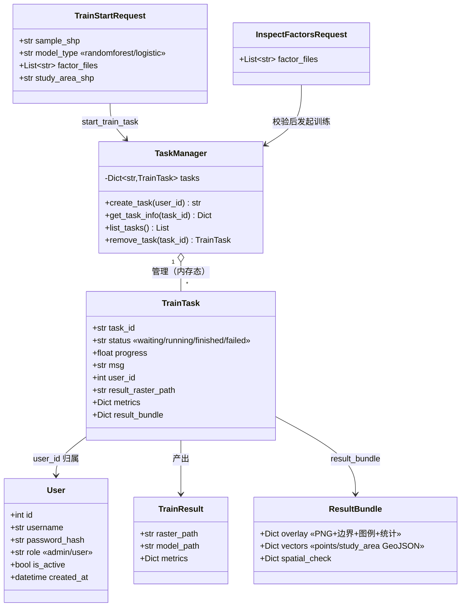
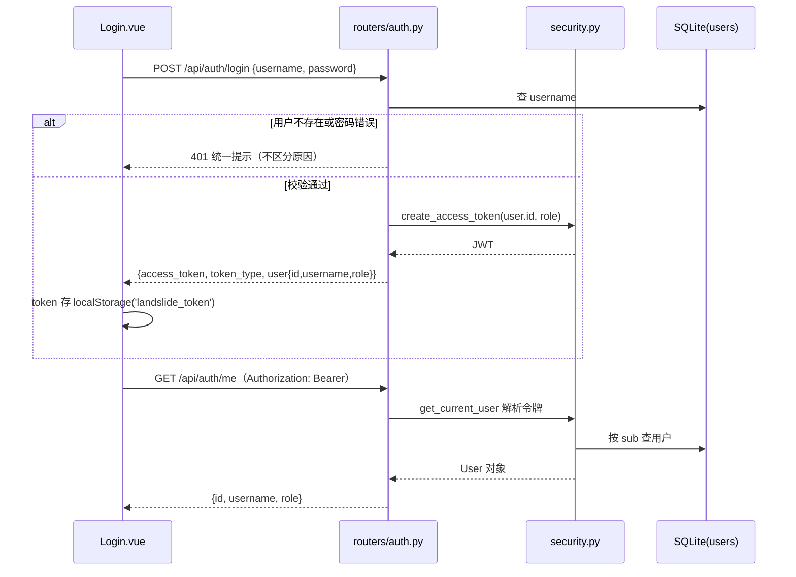
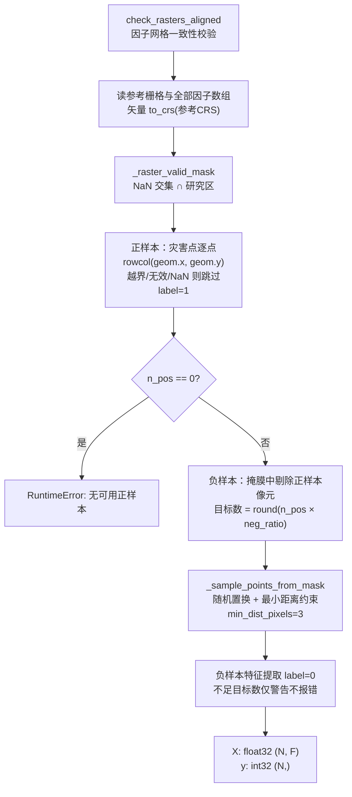
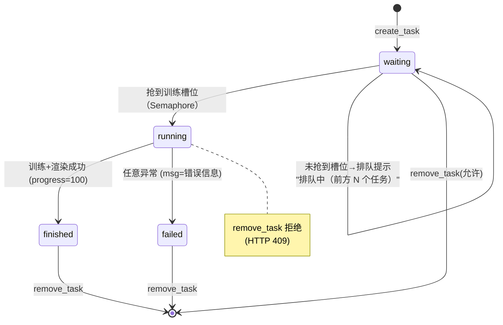
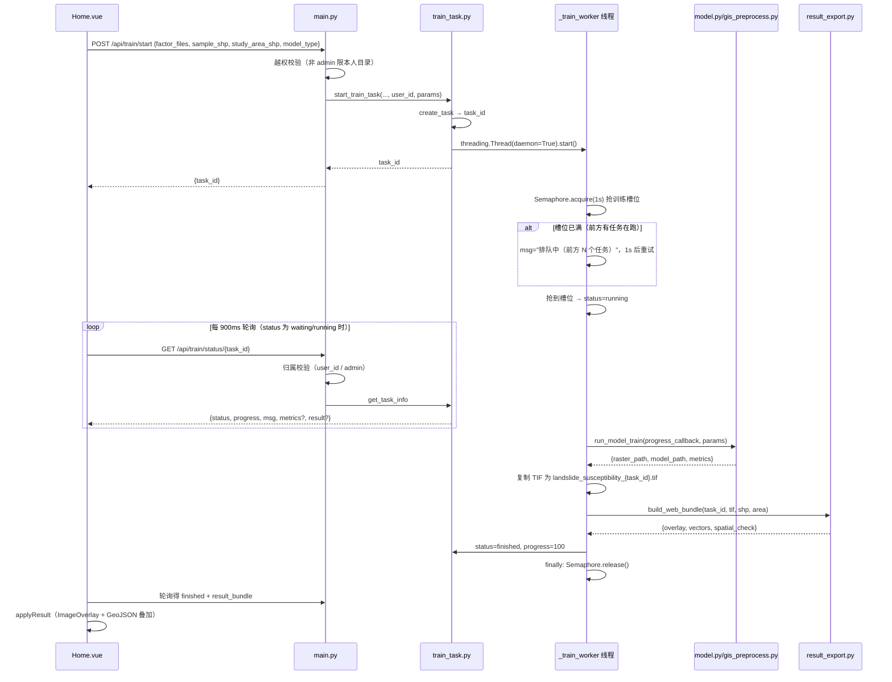
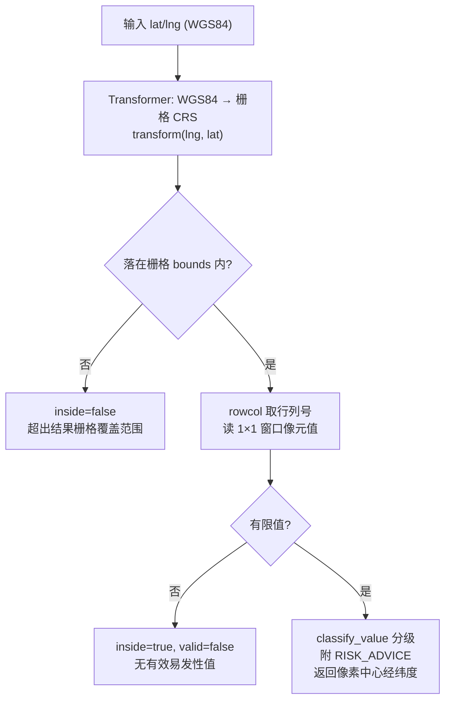

# 滑坡易发性评价 WebGIS 平台 —— 系统详细设计说明书

| 项目名称 | 滑坡易发性评价 WebGIS 平台 |
|---|---|
| 文档编号 | LS-WGIS-LLD-001 |
| 版本 | V1.2 |
| 编写日期 | 2026-11-16（V1.0）；2026-11-18 修订至 V1.2（V1.1 功能同步、V1.2 并发承载） |
| 文档状态 | 正式发布 |
| 输入依据 | 《系统概要设计说明书》（LS-WGIS-HLD-001） |

---

## 1 引言

### 1.1 编写目的

本文档在概要设计基础上，给出各模块的函数级/类级设计、核心算法细节、关键时序图（JWT 鉴权、异步训练轮询）、类图与出错处理细则，作为编码实现对照与代码评审依据。文档中的模块、函数、参数均与当前代码实现一一对应。

### 1.2 参考资料

1. 《系统概要设计说明书》《需求分析说明书》《API 接口设计文档》《数据库与数据结构设计》
2. 后端源码：`backend/main.py`、`train_task.py`、`model.py`、`gis_preprocess.py`、`result_export.py`、`security.py`、`routers/auth.py`、`db_models.py`
3. 前端源码：`frontend/src/views/Home.vue`、`Login.vue`、`router/index.js`

---

## 2 程序系统结构（文件级）

```
backend/
├── main.py             # API 入口：上传/模型上传/训练/结果/删除/示例数据路由 + 静态挂载
├── config.py           # 环境变量配置（JWT、CORS、管理员初始账号）
├── security.py         # 口令哈希、JWT 签发校验、当前用户依赖
├── database.py         # SQLAlchemy 引擎与会话（SQLite）
├── db_models.py        # User 持久化模型
├── routers/auth.py     # /api/auth/login、/api/auth/me、/api/auth/register
├── routers/users.py    # /api/users 用户管理（admin）：列表/创建/改角色/删除
├── algorithms.py       # build_custom_pipeline：按配置动态组装 sklearn Pipeline
├── gis_preprocess.py   # 栅格读取、对齐校验、掩膜、采样、栅格保存
├── model.py            # run_model_train 训练主流程（三种模型源）
├── train_task.py       # TrainTask / TaskManager / 后台线程调度
└── result_export.py    # 分级渲染、重投影、点查询、矢量导出、空间校验、结果包

frontend/src/
├── main.js             # 应用入口
├── router/index.js     # 路由 + 登录守卫
└── views/
    ├── Login.vue       # 登录页（含注册入口）
    └── Home.vue        # 主工作台（地图/数据/训练/成果/用户管理 5 大面板）
```

---

## 3 核心类图



说明：`User` 为 SQLite 持久化实体（SQLAlchemy）；`TrainTask` 为内存 dataclass，生命周期随服务进程；`TrainStartRequest`/`InspectFactorsRequest` 为 Pydantic 请求模型；`TrainResult`（run_model_train 返回）与 `ResultBundle`（build_web_bundle 返回）为纯数据字典结构。

---

## 4 认证模块详细设计

### 4.1 模块组成

| 单元 | 职责 |
|---|---|
| `config.py` | 提供 `JWT_SECRET`（.env 必配，缺失启动报错）、`JWT_ALGORITHM`（默认 HS256）、`ACCESS_TOKEN_EXPIRE_MINUTES`（默认 480）、`ADMIN_USERNAME/ADMIN_PASSWORD`（初始管理员）、`TRAIN_MAX_CONCURRENT`（训练并发上限，默认 2）、`TRAIN_N_JOBS`（CPU 核数÷并发上限，供 sklearn n_jobs） |
| `db_models.User` | 用户表模型：id、username（唯一索引）、password_hash、role（admin/user）、is_active、created_at |
| `security.py` | 口令与令牌工具 + FastAPI 依赖 |
| `routers/auth.py` | 登录、注册、当前用户查询 |
| `routers/users.py` | 用户管理（admin）：列表 / 创建 / 改角色 / 删除 |

### 4.2 函数设计（security.py）

| 函数 | 签名 | 设计要点 |
|---|---|---|
| `hash_password` | `(password: str) -> str` | bcrypt 哈希（passlib CryptContext） |
| `verify_password` | `(password, password_hash) -> bool` | 常数时间校验 |
| `create_access_token` | `(user_id: int, role: str) -> str` | payload 含 `sub`=user_id、`role`、`exp`；HS256 签名 |
| `get_current_user` | FastAPI 依赖 `-> User` | 解析 Bearer 令牌 → 查库校验用户存在且 `is_active`；失败统一抛 401"登录已过期，请重新登录" |
| `require_admin` | FastAPI 依赖 `-> User` | 角色非 admin 抛 403，预留管理接口扩展 |

### 4.3 JWT 鉴权时序图



前端路由守卫（`router/index.js`）：`beforeEach` 检查 `meta.requiresAuth` 与 localStorage 令牌，无令牌重定向 `/login?redirect=...`；已登录访问 `/login` 重定向 `/`。

### 4.4 用户数据隔离（贯穿各接口）

- 上传文件按用户分目录：`uploads/{user.id}/{uuid}/`（模型存 `uploads/{user.id}/models/`）；
- 训练任务记录 `user_id`（发起人）；
- 非 admin 用户仅能：查看/删除自己的任务与文件、仅能用自己目录下的数据文件或内置示例数据发起训练（`train_start` 对 factor_files/sample_shp/study_area_shp/**custom_model_path** 统一做 `check_path_valid`：os.path.relpath 不以 `..` 开头，大小写与斜杠归一，跨盘符直接拒绝；放行条件 = 位于 `uploads/{user.id}/` **或** `data/raw/` 示例目录）；
- admin 可访问全部任务与文件。

### 4.5 用户管理接口（routers/users.py，全部 `Depends(require_admin)`）

| 接口 | 函数 | 设计要点 |
|---|---|---|
| `GET /api/users` | `list_users` | 按 id 序返回全部用户（id/username/role/is_active） |
| `POST /api/users` | `create_user` | role 仅 admin/user（否则 400）；用户名重复 400；口令 bcrypt 哈希入库 |
| `PATCH /api/users/{id}` | `update_user_role` | 只改角色；**禁止改自己的角色**（400，防锁死管理权限）；用户不存在 404 |
| `DELETE /api/users/{id}` | `delete_user` | **禁止删自己**（400）；物理删除；用户不存在 404 |

注册（`POST /api/auth/register`）无需鉴权，仅接受 username/password，注册即 `role=user`，重名 400。

---

## 5 文件管理模块详细设计

### 5.1 上传接口设计

| 接口 | 输入 | 处理逻辑 | 输出 |
|---|---|---|---|
| `POST /api/upload` | `file` 单文件或 `files` 多文件 | 存至 `uploads/{uid}/{uuid}/`；若为 .zip 自动解压、`_flatten_extract` 抹平单层子目录、收集内部 .shp | `{upload_dir, files:[{filename, path, from_zip?}], msg}` |
| `POST /api/upload/batch` | `files` 多文件 | 批量保存，返回各文件绝对路径 | 同上 |
| `POST /api/upload/shapefile` | `files` 多文件（.shp/.shx/.dbf/.prj 等） | 存至 `uploads/{uid}/{uuid}/`；定位 .shp 主文件（须存在）、校验同名 .prj，geopandas 解析并强制转 WGS84，返回边界与 GeoJSON 预览 | `{shp_path, bounds, geojson, msg}` |
| `POST /api/model/upload` | `file` .joblib/.pkl | 后缀白名单 → `os.path.basename` 文件名清洗（防 `../` 穿越）→ 存 `uploads/{uid}/models/` | `{model_path, msg}` |

要点：
1. 路径取 `os.path.basename(filename)` 防上传路径穿越；
2. 返回绝对路径，前端原样回传给训练/校验接口；
3. `.zip` 为可选扩展：合法 zip 解压收集内部 .shp；非法 zip 静默跳过（按普通文件保存，不报错）。

### 5.2 删除接口设计（`DELETE /api/delete`）

查询参数：`target`（`task|file`，正则约束）、`task_id`、`path`。

**删除任务（target=task）**：
1. 任务不存在 → 404；越权（非 admin 且非发起人）→ 403；
2. `TaskManager.remove_task`：状态为 waiting/running 抛 RuntimeError → 映射 409"任务正在运行，无法删除"；
3. 清理 `result/` 下文件名含 task_id 的全部产物（TIF/PNG/GeoJSON/结果包），返回删除文件清单。

**删除文件（target=file）**：
1. 非 admin：目标须位于 `uploads/{user.id}` 内（realpath + commonpath 比对），否则 403"无权删除他人的文件"；
2. `_ensure_within`：目标须位于 `uploads/` 内，否则 403"仅允许删除上传目录内的文件"（`data/raw` 示例数据受此保护）；
3. 支持删目录（rmtree）或单文件；删 .shp 时级联清理 `_SHP_SIDECARS`（.shx/.dbf/.prj/.cpg/.sbn/.sbx/.qpj/.shp.xml）同名边车文件。

---

## 6 GIS 预处理模块详细设计（gis_preprocess.py）

### 6.1 函数清单

| 函数 | 签名 | 职责 |
|---|---|---|
| `read_raster` | `(raster_path) -> (arr, profile, transform, crs, nodata)` | 读单波段为 float32；文件声明的 nodata 统一置 NaN |
| `check_rasters_aligned` | `(factor_paths) -> True` | 校验各因子 (shape, transform, crs) 三元组完全一致；缺 CRS、文件不存在、不一致均抛 ValueError/FileNotFoundError |
| `_raster_valid_mask` | `(factor_paths, study_area_gdf, ref_transform, ref_shape) -> bool[H,W]` | 有效像元 = 所有因子非 NaN 交集 ∩ 研究区面内（`geometry_mask(invert=True)`） |
| `_sample_points_from_mask` | `(mask, n, rng, exclude_rc, min_dist) -> [(row,col)]` | 掩膜内随机取 n 个像元坐标；用 `NearestNeighbors` 保证与排除点（正样本）距离 ≥ min_dist 像元 |
| `sample_points_auto_label` | `(factor_paths, landslide_shp, study_area_shp=None, neg_ratio=3.0, min_dist_pixels=3, random_state=42, study_area_buffer=0.0) -> (X, y)` | 构建训练集，见 6.2 |
| `save_prediction_raster` | `(ref_profile, pred_arr, out_tif_path) -> path` | 沿用参考 profile 写 float32 单波段，nodata=NaN |

### 6.2 样本采样算法



设计要点：
1. 非 Point 几何取 `centroid`；坐标经 `rasterio.transform.rowcol` 转像元行列号；
2. 负样本与正样本保持 ≥ 3 像元距离，降低空间自相关导致的评估虚高；
3. 正负比默认 3:1（`neg_ratio=3.0`）；
4. 随机种子固定（42），结果可复现。

---

## 7 机器学习模块详细设计（model.py）

### 7.1 主函数

`run_model_train(factor_files, landslide_shp, study_area_shp=None, model_type="randomforest", test_size=0.3, random_state=42, progress_callback=None, custom_model_path=None, pipeline_config=None, params=None) -> {raster_path, model_path, metrics, feature_importances}`

**params 超参数字典**（由前端随 train/start 提交，经 `TrainStartRequest.params` → `start_train_task(params=...)` → `run_model_train(params=...)` 显式传递，**不可用 `**` 解包**——否则会落入 `**kwargs` 被吞掉，参见 AI 错误案例集 EC-08）：

| 键 | 默认 | 消费点 |
|---|---|---|
| neg_ratio | 3.0 | 采样负:正比例 |
| n_estimators | 100 | RF 树数（传统 / pipeline） |
| lr_C | 1.0 | 逻辑回归 C（传统 / pipeline） |
| svm_C | 1.0 | pipeline 中 SVC 的 C |
| svm_kernel | "rbf" | pipeline 中 SVC 的 kernel |

### 7.2 训练流水线与进度映射

| 进度点 | 阶段 | 实现 |
|---|---|---|
| 3% | 校验 | `check_rasters_aligned` |
| 10% | 采样 | `sample_points_auto_label` |
| 25% | 划分 | `train_test_split(test_size=0.3, stratify=y, random_state=42)` |
| 40% | 训练 | 模型 fit |
| 70% | 评估 | predict_proba → 阈值 0.5 离散 → 指标计算 |
| 85% | 全区预测 | 掩膜内像元批量 predict_proba |
| 100% | 输出 | 保存栅格与模型 |

（`train_task._progress_msg` 据此给出阶段文案：<10 读取校验、<25 采样、<40 划分、<70 训练、<85 评估、<100 预测渲染、100 完成。）

### 7.3 模型设计（三种模型源，按优先级选择）

| 优先级 | 模型源 | 说明 |
|---|---|---|
| 1 | `custom_model_path`（上传模型） | `joblib.load` 直接加载，**跳过训练**；须含 `predict_proba`，否则 ValueError；路径不存在直接报错（禁止静默回退默认训练） |
| 2 | `pipeline_config`（搭积木） | `algorithms.build_custom_pipeline(config, params)` 动态组装 Pipeline 并 fit |
| 3 | `model_type`（传统训练） | 见下表，超参从 params 读取 |

**传统训练：**

| model_type | 估计器 | 关键超参 |
|---|---|---|
| `randomforest` | `RandomForestClassifier` | n_estimators=params.n_estimators（默认 100）, random_state=42, n_jobs=TRAIN_N_JOBS（并发训练均分 CPU，不抢核） |
| `logistic` | `Pipeline(StandardScaler → LogisticRegression)` | C=params.lr_C（默认 1.0）, max_iter=1000, random_state=42 |
| 其他 | — | `ValueError: 未知 model_type` |

**build_custom_pipeline（algorithms.py）**——三段积木按序拼接：

| 段 | 配置键 | 取值与实现 |
|---|---|---|
| 预处理 | preprocessor | none / standard（StandardScaler）/ minmax（MinMaxScaler） |
| 降维 | reducer | none / pca（PCA(n_components=0.95)） |
| 算法 | algorithm | randomforest（n_estimators=params）/ svm（SVC(C, kernel, probability=True)）/ logistic（LogisticRegression(C)） |

算法键非法抛 `ValueError: 不支持的算法类型`。Pipeline 取末级分类器做特征重要性提取。

**特征重要性（feature_importances）**：评估后统一提取，键为因子文件名（去扩展名），按值降序、4 位小数——

- 末级分类器有 `feature_importances_` → 直接取；
- 否则有 `coef_` → `|coef_[0]|` 归一化；
- 否则全 0 占位；提取异常仅告警不阻断（返回空字典）。

### 7.4 评估指标

`y_prob = predict_proba(X_test)[:,1]`，`y_hat = (y_prob > 0.5)`：

| 指标 | 计算 |
|---|---|
| AUC | `roc_auc_score` |
| Accuracy | `accuracy_score` |
| Precision / Recall / F1 | 对应 sklearn 指标（zero_division=0） |

均 round 到 4 位小数，随任务状态返回前端。

### 7.5 全区预测与输出

1. 以第一个因子为参考（shape/transform/crs/profile）；
2. 全部因子 ravel 后按**训练时相同顺序** stack 为 (H*W, F)；
3. `_raster_valid_mask`（含研究区）确定预测范围，掩膜外保持 NaN —— 研究区外不出现无意义风险值；
4. `save_prediction_raster`：profile 更新为 float32、单波段、nodata=NaN 写 `result/landslide_susceptibility.tif`；
5. 模型 joblib 保存至 `models/{model_type}_model.joblib`；
6. 返回后 `train_task` 将 TIF 复制为 `result/landslide_susceptibility_{task_id}.tif`，保证并发任务结果互不覆盖。

---

## 8 异步训练轮询流程设计（train_task.py）

### 8.1 数据结构

```python
@dataclass
class TrainTask:
    task_id: str              # uuid4
    status: str               # waiting / running / finished / failed
    progress: float           # 0~100
    msg: str                  # 阶段文案 / 错误信息
    user_id: int = 0          # 发起人（数据隔离）
    params: dict = None       # 前端超参数（neg_ratio/n_estimators/lr_C/svm_C/svm_kernel）
    result_raster_path: str   # 任务独立结果 TIF
    metrics: Dict[str, float] # AUC/Accuracy/Precision/Recall/F1 + feature_importances
    result_bundle: Dict       # build_web_bundle 结果包
```

### 8.2 TaskManager 接口

| 方法 | 设计 |
|---|---|
| `create_task(user_id, params=None) -> task_id` | uuid4，初始 waiting / progress=0，记录超参数 |
| `get_task_info(task_id) -> dict` | 不存在返回 `{"status": "not_found"}`；否则返回任务全量字段（含 result_bundle） |
| `list_tasks() -> [dict]` | 历史任务摘要列表（含 user_id） |
| `remove_task(task_id)` | waiting/running 抛 RuntimeError（409）；否则 pop 返回 |

单例 `task_manager` 全局共享；任务表为内存态（重启不恢复，见概要设计约束）。

### 8.3 任务状态机



> waiting 期间任务线程每 1s 重试抢槽位并刷新排队文案；抢到槽位后 status 置 running 进入训练流水线。

### 8.4 异步训练轮询时序图（核心）



要点：
1. 线程 daemon=True，进程退出不阻塞；
2. `on_progress` 回调直接写 task 对象字段，轮询读取（单机内存共享）；
3. 异常捕获后 `traceback.print_exc()` 记日志，status=failed，msg 带异常文本；
4. 渲染阶段进度 95（build_web_bundle 前），成功后置 100；
5. 前端 `pollStatus` 用 setTimeout 链（900ms）而非 setInterval，避免轮询重入。

### 8.5 训练并发闸门设计（V1.2 新增）

```python
# 模块级（train_task.py 顶部，进程内共享）
_train_slots = threading.Semaphore(max(1, TRAIN_MAX_CONCURRENT))  # 默认 2

# _train_worker 开头：排队等槽位
while True:
    if _train_slots.acquire(timeout=1.0):   # 1s 内抢到即开跑
        break
    task.msg = f"排队中（前方 {ahead} 个任务），等待空闲训练资源"  # _queue_ahead 统计
task.status = "running"
...
finally:
    _train_slots.release()   # 成功/失败都释放，排队任务顶上
```

| 设计点 | 说明 |
|---|---|
| 闸门粒度 | 进程级信号量，控制**同时真正在跑的训练线程数**（TRAIN_MAX_CONCURRENT，默认 2，`.env` 可配 1~4） |
| 排队提示 | `_queue_ahead(task_id)` 按任务创建顺序统计前方 waiting 数，写入 task.msg，前端轮询直接展示 |
| 重试机制 | `acquire(timeout=1.0)` 非阻塞循环：每秒重试并刷新前方任务数，避免忙等 |
| CPU 均分 | `TRAIN_N_JOBS = os.cpu_count() // TRAIN_MAX_CONCURRENT`，传入 RF `n_jobs`，2 个并发训练各占一半核，不互相抢核 |
| 释放保障 | try/finally 保证任何异常都 release，不泄漏槽位 |
| 并发写防护 | 中间栅格名 `landslide_susceptibility_{uuid8}.tif` 防覆盖；`joblib.dump` 加模块级 `_dump_lock` 防同名模型并发写坏 |
| 读接口不受影响 | 点查询/登录/轮询走独立请求线程，不经过闸门；SQLite WAL 读写不互斥 |
| 明确不做 | 多 uvicorn worker / Redis / Celery —— 任务表为内存态，跨进程不共享，属二期方向 |

---

## 9 成果导出模块详细设计（result_export.py）

### 9.1 分级与配色常量

| 常量 | 值 |
|---|---|
| `BREAKS` | [0.2, 0.4, 0.6, 0.8] |
| `CLASSES` | 5 级：very_low #2c7bb6 / low #7fcdbb / moderate #ffffb2 / high #fdae61 / very_high #d7191c |
| `GRADIENT_STOPS/COLORS` | 0~1 六锚点连续渐变（至 #7f0000） |
| `FACTOR_COLORS` | viridis 风格五段色带（因子渲染，按 2%~98% 分位归一化） |
| `RISK_ADVICE` | 5 级防护建议话术，与 CLASSES 的 key 一一对应 |
| `MAX_PNG_WIDTH` | 1600（PNG 最大宽度，超出等比缩小） |
| `WGS84` | "EPSG:4326" |

### 9.2 核心函数设计

| 函数 | 职责与要点 |
|---|---|
| `classify_value(value)` | `np.digitize(value, BREAKS)` 映射 5 级，返回 `{key,name,min,max,color,value}`；非有限值返回 None |
| `format_risk_message(value, lng, lat)` | 拼接弹窗文案："该点风险值为 X.XX，属于 XX，建议…" |
| `_colorize(arr)` | 连续渐变映射 RGBA，NaN 全透明 |
| `_reproject_to_wgs84(src, src_arr)` | 重投影至 EPSG:4326 等经纬网格，返回数组 + (W,S,E,N) 边界 + 目标尺寸 —— PNG 行列与经纬度线性对应，ImageOverlay 贴图与 GeoJSON 严格对齐 |
| `export_web_overlay(task_id, tif_path)` | 结果 TIF → 渐变 PNG + 边界 + 图例 + 分级统计；**分级统计基于原始投影栅格**（避免重采样偏差） |
| `export_factor_overlay(factor_path)` | 因子 TIF → viridis PNG（文件名带 md5 摘要防冲突）+ 边界 + 值域 |
| `export_vectors(task_id, sample_shp, study_area_shp)` | 矢量显式 `to_crs(4326)` 导出 GeoJSON（缺 .prj 报错），返回 url + count |
| `spatial_check(tif_path, sample_shp, study_area_shp)` | 校验结果与样本/研究区空间套合，输出检查项列表，支撑空间逻辑校验报告 |
| `query_point(tif_path, lat, lng)` | 见 9.3 |
| `inspect_factors(paths)` | 逐因子输出 crs/shape/transform 摘要 + aligned 布尔 + 参考 CRS/尺寸 |
| `bounds_wgs84(raster_path)` | `transform_bounds` densify 后的 WGS84 边界 |
| `build_web_bundle(task_id, tif, sample_shp, study_area_shp)` | 汇总 `{overlay, vectors, spatial_check}` 结果包，任务完成时一次性生成 |

### 9.3 点查询算法（query_point）



返回结构（有效时）：`{inside, valid, lat, lng, pixel{row,col,lat,lng}, key,name,min,max,color,value, advice}`，前端弹窗直接展示 value、name、advice。

### 9.4 前端成果导出（Home.vue，Canvas 合成）

1. **导出风险图 PNG**（`exportPng`）：Canvas 合成风险图 PNG + 渐变色带图例 + 分级面积占比 + 模型指标（AUC 等）→ `toDataURL` 触发下载；
2. **下载结果 TIF**（`downloadTif`）：取 `tif_url`（/static/…）直接下载带投影源文件；
3. **删除结果**（`deleteTaskResult`）：ElMessageBox 二次确认 → `DELETE /api/delete?target=task&task_id=...`；
4. **下载特征重要性图**（`downloadChart`）：ECharts `getDataURL`（2 倍像素、白底）导出图表 PNG，文件名带日期。

---

## 10 前端模块详细设计

### 10.1 页面与状态

**Login.vue**：表单提交 → `POST /api/auth/login` → 存 `landslide_token` → 跳转 redirect 或 `/`。

**Home.vue** 核心响应式状态：

| 状态 | 含义 |
|---|---|
| `factorFiles[] / sampleShp / studyArea` | 数据就绪状态（含服务端 path） |
| `inspect` | 因子投影/网格校验结果 |
| `modelType` | randomforest / logistic |
| `training / progress / msg / elapsed / trainFailed` | 训练进度展示 |
| `taskId / metrics / bundle` | 任务与结果 |
| `layerVisible{factors,result,points,study}` | 图层显隐 |
| `opacity / baseKey / factorOverlays` | 渲染透明度、底图、因子叠加 |

模块级变量：Leaflet `map`、`overlay`（风险图 ImageOverlay）、`pointsLayer / studyLayer`（GeoJSON）、`pollTimer`（setTimeout 链，900ms）、`elapsedTimer`（秒表）。

### 10.2 关键函数

| 函数 | 设计要点 |
|---|---|
| `initMap` | Leaflet 初始化，卫星底图（瓦片失败自动降级"无底图"），`resultPane` 保证风险图压盖顺序 |
| `loadDemo` | `GET /api/demo/dataset` 回填 factor_files/sample_shp/study_area_shp + 触发校验 |
| `uploadFactor / uploadZip` | Element Plus upload → `/api/upload`、`/api/upload/shapefile`，回填服务端路径 |
| `runInspect` | `POST /api/factors/inspect`，展示 aligned/crs/shape 结论，训练前置门槛 |
| `startTrain` | 前置 `canTrain` 校验 → POST train/start → 记 task_id → `pollStatus` |
| `pollStatus` | 900ms setTimeout 链轮询；finished → `applyResult`；failed → 错误提示；网络异常终止轮询 |
| `applyResult` | 由 `overlay.bounds` 建 `L.imageOverlay(png_url, bounds)`，fitBounds 视口定位；`loadVectors` 叠加研究区虚线面 + 灾害点 circleMarker（属性弹窗） |
| `loadFactorOverlays / toggleFactor` | 因子叠加 PNG 按需渲染，图层开关 |
| `exportPng / downloadTif / deleteTaskResult` | 成果导出与删除（9.4） |
| `removeFactor / clearShp / deleteServerFile` | 列表移除 + 服务端删除（示例数据仅前端移除，`isUploaded` 判定 `data/raw` 受保护路径） |
| 点击查询 | map click → `GET /api/result/query?task_id&lat&lng` → 弹窗展示等级/概率/防护建议 |

### 10.3 轮询状态处理

| 轮询响应 | 前端行为 |
|---|---|
| status=waiting/running | 更新 progress/msg，900ms 后继续轮询 |
| status=finished | 停表；写 metrics；`applyResult(result_bundle)`；成功提示 |
| status=failed | 停表；trainFailed=true；错误提示 data.msg |
| 其他/not_found | 停表；状态异常提示 |
| 请求异常 | 停表；"查询训练状态失败"提示 |

---

## 11 接口详细设计说明

全量接口的请求/响应字段定义见《API 接口设计文档》。本节补充接口层的统一设计约定：

1. **鉴权**：除登录外全部业务接口挂 `Depends(get_current_user)`；
2. **路径参数化**：前端回传服务端返回的绝对路径，后端 `_abs()` 兼容相对/绝对路径；
3. **请求体兼容**：`/api/train/start` 接受单对象或单元素数组（`Union[TrainStartRequest, List[...]]`），兼容部分 API 工具的包装行为；
4. **状态码约定**：400 参数/数据问题、401 未认证、403 越权、404 不存在、409 任务运行中不可删、422 参数缺失/校验失败；
5. **静态服务**：`/static` 挂载 `result/`，渲染 PNG/GeoJSON/结果 TIF 经该前缀访问；单服务模式下 `/` 挂载 `frontend/dist`（auth 路由须先于静态挂载注册，否则被 405/404 吞掉）。

---

## 12 出错处理详细设计

| 场景 | 检测点 | 处理 |
|---|---|---|
| 栅格缺 CRS | `check_rasters_aligned` / `export_web_overlay` | ValueError → 400 / 任务 failed，提示补 .prj/投影 |
| 因子网格不一致 | `check_rasters_aligned` | 报错信息含文件名、shape、crs 对比 |
| 无可用正样本 | `sample_points_auto_label` | RuntimeError → 任务 failed"请检查灾害点是否落在研究区/因子范围内" |
| 负样本不足 | `_sample_points_from_mask` | 打印警告继续训练（不中断） |
| 未知模型 | `run_model_train` | ValueError → 任务 failed |
| 矢量缺 .prj | `export_vectors` | ValueError → 任务 failed（渲染阶段） |
| 任务不存在/未完成 | 各查询接口 | 404 / 400 |
| 运行中删除任务 | `remove_task` | 409 |
| shp 文件组无 .shp / 缺 .prj / 解析失败 | 上传接口 | 400 明细提示 |
| 模型文件后缀非法/文件名非法 | `upload_model` | 400"仅支持 .joblib 或 .pkl 文件" / "文件名不合法" |
| 上传模型缺 predict_proba | `run_model_train` | ValueError → 任务 failed"上传的模型必须是分类模型…" |
| custom_model_path 不存在 | `run_model_train` | ValueError → 任务 failed"自定义模型文件不存在"（**禁止静默回退默认训练**） |
| pipeline 算法键非法 | `build_custom_pipeline` | ValueError → 任务 failed"不支持的算法类型" |
| 非 admin 越权用他人模型/数据路径 | `train_start.check_path_valid` | 403"无权使用他人的数据文件" |
| 非 admin 越权查看他人任务 | `get_task_status` | 403"无权查看该任务" |
| 改自己的角色 / 删自己 | users 路由 | 400 提示 |
| 点查询出界/无值 | `query_point` | 200 + inside/valid 标志 + 文案（非错误） |
| 前端瓦片加载失败 | `initMap onTileError` | 自动降级无底图模式 |

---

## 13 测试要点映射

| 详细设计单元 | 建议测试要点 |
|---|---|
| 认证模块 | 登录/注册成功/失败、令牌过期、401/403 数据隔离、用户管理自保与越权 |
| 文件管理 | 上传三接口、模型上传、shp 文件组校验（.shp/.prj）、删除越权（uploads 外/他人目录/示例数据） |
| GIS 预处理 | 网格不一致拒绝、正样本为 0 拒绝、负样本距离约束、可复现性（固定种子） |
| 训练模块 | 三模式训练（传统调参 / pipeline 搭积木 / 上传模型）、**超参数实际生效**（落盘模型属性回读验证）、特征重要性输出、进度单调递增至 100、失败路径 |
| 任务管理 | 状态机流转、运行中删除 409、任务列表过滤（user_id 归属） |
| 成果导出 | 5 级阈值边界值分类、点查询出界/无值、PNG/TIF 导出内容完整 |
| 前端 | 轮询终止条件、图层开关、点查询弹窗、示例数据一键载入 |

---

*文档结束*
