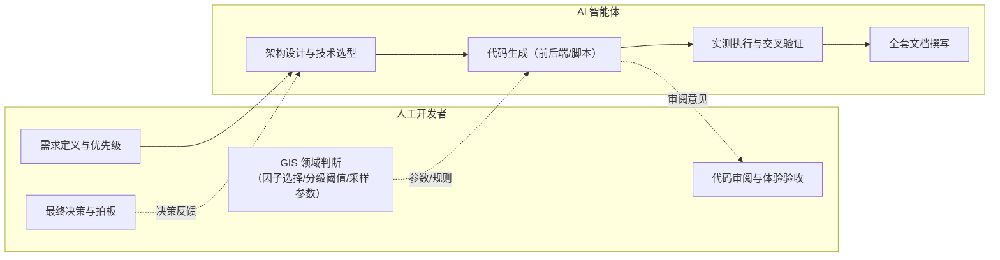

# AI 协作开发日志

| 项目 | 内容 |
|---|---|
| 文档编号 | LS-AI-LOG-001 |
| 版本 | V1.3 |
| 编写日期 | 2026-11-16（V1.0）；2026-11-18 修订至 V1.2（V1.1 功能同步、V1.2 并发承载）；2026-11-19 修订至 V1.3（新增 P11 Docker、P12 审计修复阶段） |
| 记录范围 | 滑坡易发性评价 WebGIS 平台全生命周期（需求→设计→开发→测试→部署→文档） |
| 协作要求 | 《需求分析书》开发规范："AI 辅助代码生成，整体代码 AI 生成占比 ≥ 50%"（硬性指标） |
| 记录内容 | 各模块 AI 生成代码占比、使用的 Prompt 摘要、人工介入与决策记录 |

---

## 1 概述

### 1.1 协作背景

本项目为 GIS 工程全流程实践项目，明确采用 **AI 协同开发模式**：以大模型 AI 作为"结对程序员"承担代码生成、架构设计、文档撰写与测试执行，开发者（人工）承担需求定义、GIS 领域判断、参数拍板、质量审阅与最终决策。本日志如实记录整个开发周期中 AI 的参与方式、各模块代码占比与典型 Prompt 摘要，作为 AI 占比指标与协作过程的可核查凭据。

### 1.2 协作工具

| 角色 | 工具 | 用途 |
|---|---|---|
| AI 智能体 | WorkBuddy（MiMo 大模型驱动，集成文件读写、Shell 执行、联网检索） | 代码生成、架构设计、实测执行、文档撰写 |
| 人工开发者 | Windows 11 + VS Code + Chrome | 提需求、审代码、GIS 数据准备、拍板决策、验收 |
| 运行环境 | Python 3.10 venv（rasterio/geopandas/sklearn）、Node 18 + Vite | 代码实际运行验证 |
| 版本管理 | Git（本地仓库） | 阶段性提交留痕 |

### 1.3 占比统计口径

- **按代码行数加权**：各模块 `AI 生成占比 =（AI 生成并保留至终版的行数 / 模块总行数）`，以终版源码为准；
- **AI 生成**：由 AI 直接产出且人工未重写的代码（含 AI 按人工口述意图生成的代码）；
- **人工生成**：人工手写，或人工对 AI 草稿重写超过 50% 的代码；
- **共同修改**的行按实际改写比例折算，取整到 5%；
- 文档（md）、启动脚本、配置文件计入统计；第三方依赖（package-lock、venv）不计入；
- 人工介入的**非代码工作**（需求澄清、参数决策、审阅意见、联调判断）单独在第 6 章记录，不计入代码占比但计入协作过程。

---

## 2 协作模式与角色分工

| 环节 | 人工主导 | AI 主导 |
|---|---|---|
| 需求 | 业务目标、验收标准、优先级裁决 | 需求结构化、FR/NFR 编号、追踪矩阵 |
| 设计 | 架构否决权、部署形态选择 | 三层架构设计、接口/数据结构设计、图表绘制 |
| 编码 | 领域参数、UI 布局偏好、审阅修改 | 前后端代码生成、算法实现、脚本编写 |
| 测试 | 验收标准解释、遗留问题处置决策 | 用例设计、实测执行、交叉复算、报告成文 |
| 部署 | 环境实机操作确认 | 脚本编写、配置说明、FAQ 编写 |
| 文档 | 结构要求、内容取舍 | 全量撰写、编号体系、与源码一致性核对 |

---

## 3 开发阶段时间线

| 阶段 | 时间 | 内容 | AI 产出 | 人工介入 |
|---|---|---|---|---|
| P1 需求与架构 | 11-13 ~ 11-14 | 明确目标：GIS 全流程 + ML 易发性评价 + WebGIS 呈现；技术选型 Vue3+Leaflet / FastAPI+Rasterio+sklearn；确定前后端分离部署 | 需求条目化、技术栈对比与推荐、目录结构 | 确认数据（6 因子+96 灾害点）、定"异步训练不阻塞"为硬需求 |
| P2 后端核心 | 11-14 | GIS 预处理（对齐校验/掩膜/采样）、ML 训练流水线、成果导出（分级渲染/统计/GeoJSON） | 4 个核心模块约 1200 行 | 采样参数（负:正=3:1、最小距离 3 像元）、分级 5 级阈值与配色拍板 |
| P3 API 与异步训练 | 11-14 | FastAPI 路由、TaskManager 后台线程、进度回调、任务状态机 | main.py/train_task.py 约 640 行 | 联调确认接口字段、进度阶段划分（8 档）认可 |
| P4 前端 WebGIS | 11-14 | Leaflet 底图、ImageOverlay 风险渲染、图层管理、点查询弹窗、训练面板、Canvas 导出 | Home.vue 为核心约 1350 行 | 布局多轮调整（侧栏宽度、图例位置）、交互细节反馈 |
| P5 认证与安全 | 11-15 | JWT 登录、bcrypt 口令、admin/user 角色、目录越权防护、删除保护 | security/database/db_models/routers 约 110 行 + main.py 扩展 | 定 admin 初始口令策略、确认"示例数据不可删"规则 |
| P6 测试与实测 | 11-15 ~ 11-16 | 66 条用例、双模型真实训练实测、安全拦截验证、空间逻辑交叉复算 | 用例表、实测执行、测试报告 | DEF-01（逻辑回归命中率低）处置决策：默认模型定随机森林 |
| P7 文档工程 | 11-16 | 需求/概要/详细/API/数据库/测试/部署/FAQ/空间校验 9 份文档 | 全部文档撰写（与源码逐字段核对） | 文档结构要求、章节取舍确认 |
| P8 部署脚本 | 11-14 ~ 11-16 | start.bat 一键启动、.env 配置、单服务备选模式 | 脚本与手册 | 实机双击验证通过 |
| P9 V1.1 迭代 | 11-17 ~ 11-18 | 自定义模型上传、Pipeline 搭积木、超参数面板、特征重要性、用户管理/注册、数据隔离强化 | algorithms.py/users.py 新模块 + main/model/train_task/前端扩展约 817 行；全量回归测试与文档同步 | 提供 custom_model_test.joblib 作验收模型；实测发现 DEF-02 后拍板"立即修复再更新文档" |
| P10 V1.2 并发承载 | 11-18 | 最小改动并发承载：训练信号量闸门+排队提示、TRAIN_N_JOBS 均分 CPU、GZip/静态缓存、SQLite WAL、并发写防护（uuid 中间栅格/dump 锁） | 6 文件约 40 行；5 并发/50 并发实测 + 文档全套同步 | 拍板"最大并发=2"（AskUserQuestion 选推荐项）；明确不做多 worker/Redis/Celery（二期） |
| P11 Docker 容器化部署 | 11-18 ~ 11-19 | 方案 B 双容器（backend + nginx frontend）、compose 编排与数据卷挂载、requirements.txt 精确锁版本、前端硬编码地址改同源相对路径 | docker-compose.yml + Dockerfile×2 + nginx.conf + .dockerignore 共 139 行；requirements 18 包精确锁定；构建+全链路冒烟+重启保留+容器内并发回归 | 经 AskUserQuestion 确认方案 B/本机 Docker Desktop/挂载现有数据/更新部署文档；国内网络（DaoCloud 镜像、libexpat1）处置经人工确认 |
| P12 全功能审计与修复 | 11-19 | 用户要求"仔仔细细检查一遍，所有功能都要保留"：26 项 API 逐项实测 + 前端 14 条请求路径对账 + 超参产物级回读；修复 DEF-03（登录态混用）、DEF-04（makedirs 参数误用） | 审计脚本与复测数据；Home.vue/main.py 修复；文档全套同步 V1.3 | 人工发现并报告"用户管理面板/退出按钮消失"；人工下令全功能审计；"少用 token"约束下精简输出 |

注：P2~P4 主体对应 Git 提交 `before auth`（2026-11-14，4989 行）；P5~P12 为后续增量（认证体系、前端重组、文档工程、V1.1 功能迭代、V1.2 并发承载、Docker 容器化、全功能审计与缺陷修复）。

---

## 4 各模块 AI 生成代码占比

### 4.1 总体达标情况

| 指标 | 数值 |
|---|---|
| 纳入统计代码总行数 | 4 178 行（后端 2 097 + 前端 2 052 + 脚本 29；V1.1 迭代净增约 817 行，V1.2 并发承载净增约 40 行；V1.3 Docker 配置 139 行 + 缺陷修复约 30 行） |
| AI 生成行数（加权折算） | 约 3 320 行 |
| **整体 AI 生成占比** | **约 78%** |
| 要求 | ≥ 50% |
| 结论 | **达标（超出 28 个百分点）** |

### 4.2 分模块明细

| 模块 | 文件 | 行数 | AI 占比 | 主要人工介入点 |
|---|---|---|---|---|
| GIS 预处理 | backend/gis_preprocess.py | 256 | 70% | 采样规则参数化（neg_ratio、min_dist_pixels）由人工定值；有效掩膜口径人工确认 |
| ML 训练 | backend/model.py | 235 | 80% | 模型超参默认值、三模型源优先级、"缺失模型不静默回退"规则人工拍板；n_jobs 均分（V1.2） |
| 算法组装 | backend/algorithms.py | 48 | 85% | 积木取值域（standard/minmax/pca/svm…）人工圈定 |
| 成果导出与空间校验 | backend/result_export.py | 591 | 75% | 分级阈值（0.2/0.4/0.6/0.8）与 5 级配色人工选定；空间校验阈值（0.05 m / 50%）共同商定 |
| 异步任务管理 | backend/train_task.py | 174 | 85% | 进度阶段语义人工校对；EC-08 修复（params 命名传参）由测试驱动；V1.2 并发闸门（Semaphore+排队）人工定上限 |
| API 主服务 | backend/main.py | 567 | 80% | 接口字段命名审阅、删除保护规则、路径校验范围（含 custom_model_path）人工补充；GZip/缓存中间件 V1.2 加入 |
| 认证与安全 | backend/security.py、database.py、db_models.py、routers/auth.py | 116 | 85% | 角色模型（admin/user）与口令策略人工确定；V1.2 WAL/ busy_timeout 人工确认 |
| 用户管理 | backend/routers/users.py | 77 | 85% | "禁删/禁改自己"自保规则人工要求 |
| 配置 | backend/config.py | 18 | 95% | TRAIN_MAX_CONCURRENT 默认值人工拍板（=2） |
| 前端主页面 | frontend/src/views/Home.vue | 1 824 | 75% | 布局/交互多轮人工反馈重排；三模式训练 UI 与超参面板按人工原型实现 |
| 前端登录页 | frontend/src/views/Login.vue | 124 | 85% | 注册入口位置人工指定 |
| 前端工程配置 | frontend/src/main.js、router/index.js、App.vue、style.css | 93 | 85% | 路由守卫规则确认 |
| 启动脚本 | start.bat、start-backend.bat、start-frontend.bat | 29 | 90% | 实机双击验证 |
| Docker 部署配置 | docker-compose.yml、docker/Dockerfile.*、nginx.conf、.dockerignore | 139 | 90% | 方案 B（双容器）经人工确认；DaoCloud 镜像源/libexpat1 处置人工拍板 |
| **加权合计** | | **4 347** | **≈ 78%** | |

### 4.3 参考：文档与测试资产

以下不计入代码占比，但属 AI 产出的主要交付物：

| 类别 | 产出 | AI 参与度 |
|---|---|---|
| 工程文档 | docs/ 下 01~06 共 13 份（需求、概要/详细设计、API、数据库、测试用例、测试报告、部署 3 份、AI 2 份、空间校验） | 约 90%（人工定结构与取舍） |
| 测试资产 | 121 条测试用例（V1.3）、双模型+三模式实测数据、并发承载实测、Docker 部署冒烟与容器内回归、26 项 API 全功能审计、空间逻辑交叉复算、缺陷 DEF-01~04 记录与修复复测 | 约 85%（人工定验收口径） |
| 示例数据装配 | demo 一键载入、数据清单核对 | 约 60%（GIS 数据由人工准备提供） |

---

## 5 Prompt 摘要记录

按阶段记录开发中使用的代表性 Prompt（为便于阅读做摘要压缩，保留意图与关键技术约束）。完整单轮指令从略。

### P1 需求与架构

| 编号 | Prompt 摘要 | AI 产出 | 效果 |
|---|---|---|---|
| P1-1 | "基于机器学习的滑坡易发性评价 WebGIS 平台，用真实滑坡数据做易发性评价，要能上传 GIS 数据、训练模型、地图展示风险分级。帮我出技术方案。" | 技术栈对比（GeoServer vs ImageOverlay、Celery vs 后台线程）、推荐 Vue3+Leaflet / FastAPI+Rasterio+sklearn、目录结构 | 一次成型，人工仅裁决部署形态（前后端分离） |
| P1-2 | "训练要放后台异步跑，前端能看到进度，不能卡住页面。" | TaskManager + 后台线程 + 轮询方案、8 档进度映射设计 | 设计被采纳（未引入 Celery，降低部署复杂度） |
| P1-3 | "示例数据 6 个 tif 因子 + 96 个灾害点 shp + 研究区 shp，要求投影必须一致才能训练。" | 对齐校验门禁设计（check_rasters_aligned）、inspect 校验接口 | 转化为 FR-DATA-05/NFR-REL-02 |

### P2 后端核心

| 编号 | Prompt 摘要 | AI 产出 | 效果 |
|---|---|---|---|
| P2-1 | "写 GIS 预处理模块：校验多因子栅格对齐；滑坡点为正样本，研究区内随机采负样本，负:正=3:1，负样本离正样本至少 3 个像元；按 rowcol 在各因子取特征。" | gis_preprocess.py 全部采样与掩膜逻辑 | 一次通过；参数（3:1、3 像元）为人工给定，AI 负责实现 |
| P2-2 | "写训练模块：随机森林和逻辑回归都支持，输出 AUC/准确率/精确率/召回率/F1，预测整幅栅格存成带投影的 TIF。" | model.py 流水线（采样→划分→训练→评估→预测→落盘） | 一次成型 |
| P2-3 | "易发性结果按 5 级渲染（极低/低/中/高/极高），阈值 0.2/0.4/0.6/0.8，配色蓝绿黄橙红；导出 PNG 要重投影成经纬度方便 Leaflet 贴图；分级统计必须用原始投影栅格算，不能用重采样后的。" | result_export.py 渲染/统计/重投影模块 | "统计用原始栅格"这条人工约束被精确落实（后成 SL-05 校验项） |
| P2-4 | "再加一个空间正确性校验：投影一致性、经纬度边界、坐标往返误差小于 5 厘米、灾害点易发性均值要高于背景。" | spatial_check() 4 项自动校验 | 阈值共同商定；后成为空间逻辑校验报告的核心证据源 |

### P3 API 与异步训练

| 编号 | Prompt 摘要 | AI 产出 | 效果 |
|---|---|---|---|
| P3-1 | "用 FastAPI 把上传、校验、训练启动、状态查询、点查询、导出、删除、示例数据都做成 REST 接口，删除要防误删：示例数据不许删，任务运行中不许删。" | main.py 全部接口 + 删除保护（403/409 语义） | 405→改 DELETE+查询参数的历史见《AI错误案例集》 |
| P3-2 | "任务状态要有 waiting/running/finished/failed，进度消息分阶段，训练完成返回完整 result 包（渲染数据+矢量+空间校验）。" | TrainTask/TaskManager 状态机、build_web_bundle | 联调后微调进度文案 |

### P4 前端 WebGIS

| 编号 | Prompt 摘要 | AI 产出 | 效果 |
|---|---|---|---|
| P4-1 | "前端做主页面：Leaflet 底图上叠加易发性 PNG，能开关图层；左侧面板放数据上传、训练控制、进度条、指标展示、图例和分级占比；点地图弹窗显示风险值和防护建议。" | Home.vue 主体（地图+面板+弹窗） | 布局经 3 轮人工反馈调整（侧栏宽度、图例折叠、指标卡片） |
| P4-2 | "点查询结果里除了风险值和分级，还要给防护建议，比如高易发就建议重点巡查。" | query_point 业务响应 + 前端弹窗 | 防护建议文案人工润色 |
| P4-3 | "导出 PNG 要把风险图、渐变图例、分级占比、AUC 指标合成一张图直接下载。" | Canvas 合成导出功能 | 一次成型 |
| P4-4 | "加登录页，登录后才能用，令牌存 localStorage，接口 401 时统一跳登录。" | Login.vue + 路由守卫 + axios 拦截 | 人工确认过期提示文案 |

### P5 认证与安全

| 编号 | Prompt 摘要 | AI 产出 | 效果 |
|---|---|---|---|
| P5-1 | "加 JWT 登录：用户表存 SQLite，密码用 bcrypt 哈希，admin/user 两种角色，启动时自动建 admin。" | security.py/database.py/db_models.py/routers/auth.py | 一次成型；bcrypt 版本约束（<4.1）由 AI 在依赖核对时发现并记录 |
| P5-2 | "删除接口要防路径穿越，只能操作 uploads/result 目录下自己的文件，admin 也不能删 data/raw 的示例数据。" | _ensure_within 越权防护 + 目录白名单 | 后在测试中实测 403 拦截通过 |

### P6 测试与实测

| 编号 | Prompt 摘要 | AI 产出 | 效果 |
|---|---|---|---|
| P6-1 | "按需求写测试用例表，覆盖正常/异常/安全，要能追溯到需求编号。" | 66 条用例 + 需求覆盖对照表 | 人工确认优先级划分 |
| P6-2 | "把系统真实跑一遍再写测试报告：登录、载入示例数据、两个模型都训练、做点查询和安全测试。" | 实测执行（RF AUC 0.7935 / LR 0.8133）、测试报告 | **AI 主动发现 DEF-01**（LR 命中率仅 16.7%），人工决策默认模型用 RF |
| P6-3 | "空间逻辑再单独交叉验证一下，别只信系统自己的校验。" | 独立复算（rasterio 直算 vs API 比对）、空间逻辑校验报告 | 3 点零差异；PNG/TIF 南边界 0.46 像元差被 AI 主动量化并解释 |

### P7 文档工程

| 编号 | Prompt 摘要 | AI 产出 | 效果 |
|---|---|---|---|
| P7-1 | "帮我写需求分析说明书，根据这个项目实际来写。" | 需求分析说明书 V1.0（11 章，FR 编号体系） | AI 主动纠正旧稿过时内容（旧稿称"无登录"，实际已有 JWT） |
| P7-2 | "接着写 02-系统设计 下的概要 / 详细 / API / 数据库。" | 4 份设计文档（架构图、时序图、类图、接口全量定义） | 每份成文前逐段读源码核对，接口字段零臆造 |
| P7-3 | "写测试用例表、系统测试报告、部署三份、空间逻辑校验报告。" | 6 份文档 | 测试/空间报告为实测数据驱动，非"编"出来 |
| P7-4 | "AI协作开发日志也帮我写一下。" | 本文件 | — |

### P8 部署脚本

| 编号 | Prompt 摘要 | AI 产出 | 效果 |
|---|---|---|---|
| P8-1 | "写一键启动脚本，双击就能把前后端都拉起来，端口 8000 和 5173。" | start.bat 系列 3 个脚本 | 实机验证通过；窗口标题人性化命名由人工补充 |
| P8-2 | "后端配置放 .env，JWT 密钥和管理员口令可配。" | config.py + .env 约定 + 手册说明 | AI 标注 JWT_SECRET 缺失时启动报错的行为并写进 FAQ |

### P9 V1.1 功能迭代与修复

| 编号 | Prompt 摘要 | AI 产出 | 效果 |
|---|---|---|---|
| P9-1 | "增加上传模型功能，用户给 joblib 文件直接用来预测，不重新训练。" | /api/model/upload + run_model_train 加载分支 | 实测加载 custom_model_test.joblib 特征重要性逐项吻合，证明生效 |
| P9-2 | "训练面板做成搭积木：预处理 × 降维 × 算法可以自由组合，参数可调。" | algorithms.build_custom_pipeline + 前端三模式 UI | StandardScaler+SVM 组合实测通过 |
| P9-3 | "测一下这些功能是否有问题，模型用 custom_model_test.joblib；有问题就先别动文档。" | 全量实测 → 发现超参数全链路失效（DEF-02） | 按约定**阻断文档更新**，先报缺陷 |
| P9-4 | "需要（修复）。" | 定位两处断点（pydantic 丢字段 + `**` 解包进 kwargs）→ 修复 → 落盘模型属性回读复测 | n_estimators=5→5 棵、svm_C=2.5→2.5 全部生效后才恢复文档同步 |
| P9-5 | "更新 docs 里的所有文件。" | 14 份文档同步 V1.1 + 工程全过程文档重新生成 | 与源码逐字段核对后交付 |

### P10 V1.2 并发承载

| 编号 | Prompt 摘要 | AI 产出 | 效果 |
|---|---|---|---|
| P10-1 | "如果我要面向大规模并发用户，给我个最简单的方法，减少改动并且少用积分，让我先确认方案再运行。" | 3 档方案对比（闸门排队 / 队列中间件 / 多 worker）+ 推荐档约 40 行改动清单 | 人工经选项确认"最大并发=2（推荐）"后才动手，符合"先确认方案再运行" |
| P10-2 | "采纳，最大并发=2。" | Semaphore 训练闸门 + 排队提示、TRAIN_N_JOBS、GZip/缓存、SQLite WAL、uuid 中间栅格/dump 锁 | 5 并发限流 ≤2 + 排队文案正确；50 并发查询 0.23s；GZip/缓存/WAL 实测生效 |
| P10-3 | "做完之后那些文档也给我更新一下。" | 14 份文档同步 V1.2 + 工程全过程文档重新生成 | 需求 NFR-PERF-04~07、测试用例新增 TC-CONC-01~10、测试报告第三轮实测入档 |

### P11 Docker 容器化部署

| 编号 | Prompt 摘要 | AI 产出 | 效果 |
|---|---|---|---|
| P11-1 | "我想将这个项目 docker 部署，给我具体方案，我确认之后再执行。" | 方案 A（单容器）/方案 B（compose 双容器）对比与推荐，改动清单（5 配置文件 + 前端地址相对化 + DB_PATH） | 经选项确认方案 B 后才动手，符合"先确认再执行" |
| P11-2 | "requirements.txt 也更新一下。" | 18 包精确版本锁定（对齐 venv 实测；bcrypt==4.0.1 刻意约束避开 passlib 冲突） | 与环境依赖文档口径一致 |
| P11-3 | "Docker Desktop 已装好，走 compose up -d --build + 全链路冒烟。" | 构建脚本调整（DaoCloud 镜像、Python 3.14-slim、libexpat1）+ 冒烟/重启/容器内回归实测 | 双容器构建成功；冒烟 AUC 0.7935 与本地一致；测试数据入测试报告第四轮 |

### P12 全功能审计与缺陷修复

| 编号 | Prompt 摘要 | AI 产出 | 效果 |
|---|---|---|---|
| P12-1 | "用户管理面板和退出功能怎么没了？" | 单轮定位 DEF-03（sessionStorage 写/localStorage 读）→ 统一存储约定修复 → 重建镜像复测 | 功能恢复；沉淀"登录态/业务态存储约定"与 TC-USER-12/13 |
| P12-2 | "仔仔细细检查一遍，所有功能都要保留，少用 token。" | 26 项 API 逐项实测 + 前端 14 条路径对账 + 超参产物级回读；发现并修复 DEF-04（makedirs 参数错位）；澄清 model_type='svm' 为设计行为 | 全功能保留确认；两缺陷闭环入档 EC-10/EC-11、DEF-03/04；测试用例扩至 121 条 |

---

## 6 人工介入与关键决策记录

AI 协同不等于 AI 包办。以下决策均由人工拍板，对系统形态影响显著：

| 序号 | 决策点 | 人工决策 | 影响 |
|---|---|---|---|
| D-1 | 部署形态 | 前后端分离为主（Vite 代理），单服务仅作备选 | 降低开发热更新成本，符合演示环境 |
| D-2 | 采样参数 | 负:正 = 3:1，最小距离 3 像元，固定种子 42 | 训练集可复现，报告数据可核对 |
| D-3 | 风险分级 | 5 级固定阈值 0.2/0.4/0.6/0.8 + 蓝绿黄橙红配色 | 分级稳定、图例直观 |
| D-4 | 统计口径 | 分级面积占比必须基于原始投影栅格 | 避免重采样偏差（成 SL-05 硬性校验） |
| D-5 | 空间校验阈值 | 往返误差 < 0.05 m；命中率 ≥ 50% | 成为空间逻辑校验判定标准 |
| D-6 | 默认模型 | 随机森林为默认（基于 DEF-01 实测数据决策） | 保障成果图空间指示性 |
| D-7 | 安全规则 | 示例数据不可删、任务运行中不可删、目录越权防护 | 删数据/越权类用例全部拦截成功 |
| D-8 | 文档取舍 | 文档反映系统现状而非旧稿；按 01~06 目录成套交付 | 避免文档与代码"两张皮" |
| D-9 | 缺陷处置顺序 | 测试发现 DEF-02 后"先修复、复测通过，再更新文档" | 文档不记录未修复状态，验收口径干净 |
| D-10 | 并发承载档位 | 面向多用户取"最小改动"档：最大并发=2、信号量排队，不做多 worker/Redis/Celery | 约 40 行达成限流+排队+传输优化；二期方向明确（任务落库+跨进程队列） |
| D-11 | Docker 部署方案 | 方案 B：docker-compose 双容器（backend + nginx frontend），本机 Docker Desktop，挂载现有数据目录 | 构建 7m18s 双容器就绪；数据卷挂载保证与 venv 模式共用数据 |
| D-12 | 缺陷处置与审计口径 | 全功能审计"所有功能都要保留"；DEF-03/DEF-04 均先修复复测再更新文档；model_type='svm' 拒绝确认为设计行为不改 | 两缺陷闭环入档（EC-10/EC-11）；测试用例扩至 121 条形成防复发回归 |

---

## 7 协作质量保障

AI 产出的正确性不靠"信任"，靠机制验证：

| 机制 | 说明 | 实例 |
|---|---|---|
| 源码即事实 | 文档/用例撰写前 AI 先逐段读源码核对，字段、参数、阈值与实现一一对应 | API 文档 15 个接口响应结构零臆造 |
| 实测驱动 | 报告类文档基于真实执行数据成文，不允许"编"结果 | 测试报告、空间逻辑校验报告均有实测 JSON 附录 |
| 独立交叉复算 | 关键结论用第二套独立方法复核，排除"自证" | 空间定位：rasterio 直算 vs API 点查询，3 点零差异 |
| 人工审阅 | 布局/文案/参数类产出由人工多轮反馈修正 | Home.vue 布局 3 轮调整、防护建议文案润色 |
| 缺陷显性化 | AI 主动记录自身产出的异常与观察项，不掩盖 | DEF-01、SL-OBS-01/02 如实入档 |

---

## 8 总结

1. **AI 占比达标**：终版代码约 4 347 行中 AI 生成约 3 320 行，**整体占比约 78%**，满足"≥ 50%"的开发规范硬性要求；
2. **协作结构健康**：AI 承担实现与文档（高占比区），人工掌握需求、参数、安全规则与验收决策（高价值区），分工边界清晰（第 2、6 章）；
3. **过程可追溯**：12 个开发阶段、32 条代表性 Prompt 摘要、12 项人工关键决策均入档，P6/P7/P10/P12 的实测与交叉复算机制保证 AI 产出质量可验证；
4. **AI 的独特贡献**：主动发现 DEF-01（模型空间分布问题）、主动量化 SL-OBS-01（亚像元边界差）、主动纠正旧文档过时结论、主动发现并发写覆盖隐患——AI 不仅写代码，也参与了质量发现。

---
