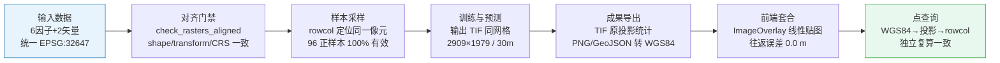

# 空间逻辑校验报告

| 项目 | 内容 |
|---|---|
| 文档编号 | LS-GIS-VERIFY-001 |
| 版本 | V1.0 |
| 编写日期 | 2026-11-16 |
| 校验对象 | 滑坡易发性评价 WebGIS 平台（前后端全链路） |
| 校验性质 | GIS 空间逻辑正确性专项校验（验收硬性项） |
| 关联文档 | 《需求分析说明书》第 7 章、《系统概要设计说明书》第 7 章、《系统详细设计说明书》第 6 章、《API 接口设计文档》、《测试用例表》TC-GIS-L01~L06、《系统测试报告》第 5 章 |

---

## 1 概述

### 1.1 校验目的

空间逻辑正确性是本项目的核心技术要求（《需求分析说明书》验收标准第 3 项："空间位置无明显偏移，风险分布符合地质常识"）。本报告对系统在**投影转换、网格对齐、像元采样、成果套合、统计口径**五个环节的空间正确性进行量化校验，回答三个问题：

1. 输入的多源 GIS 数据是否在同一空间框架下被正确对齐？
2. 样本特征提取与点位查询的空间定位是否准确（点-像元对应无误）？
3. 输出成果（TIF/PNG/GeoJSON）是否与输入空间范围一致、前端渲染是否无偏移、统计是否无重采样偏差？

### 1.2 校验依据

《需求分析说明书》第 7 章 GIS 空间逻辑需求 5 项硬性要求：

| 编号 | 要求 | 校验项对应 |
|---|---|---|
| 第7章-1 | **投影统一**：所有输入因子栅格须为同一投影坐标系；与前端地图叠加时统一转换到 WGS84（EPSG:4326）经纬度 | SL-01 |
| 第7章-2 | **网格对齐**：所有因子栅格重采样至相同分辨率、相同行列数、相同空间范围，采样前须通过投影与网格对齐校验 | SL-02 |
| 第7章-3 | **采样准确**：滑坡点/非滑坡点按坐标在各因子栅格上定位同一像元提取特征，保证特征-标签空间对应正确 | SL-03 |
| 第7章-4 | **成果一致**：预测输出栅格与输入因子栅格空间范围、分辨率保持一致；前端渲染图层与底图套合无明显偏移 | SL-04 |
| 第7章-5 | **统计口径**：分级面积占比基于原始投影栅格统计，避免重采样造成统计偏差 | SL-05 |
| 验收标准-3 | 空间位置无明显偏移，风险分布符合地质常识 | SL-06 |

### 1.3 校验方法

采用**"系统自动化校验 + 独立交叉复算"**双重手段：

| 手段 | 说明 | 作用 |
|---|---|---|
| 系统内置自动校验 | 后端 `result_export.spatial_check()` 在每次训练产出时自动执行 4 项检查（投影匹配、经纬度边界合法、坐标往返误差、风险分布合理），结果随训练状态接口返回 | 验证运行时空间逻辑自洽 |
| 因子对齐校验接口 | `POST /api/factors/inspect` 校验各因子 CRS / shape / 分辨率 / 范围一致性 | 验证输入数据空间框架 |
| 独立交叉复算 | 绕过系统 API，用 rasterio/geopandas 独立读取原始 shp 与结果 TIF，按行列号取值，与 API 点查询结果逐一比对 | 排除"系统自己查自己"的循环验证，证明定位真实正确 |
| 产物元数据核对 | 比对结果 TIF、渲染 PNG、矢量 GeoJSON 三者的空间边界与坐标系 | 验证成果套合一致性 |
| 统计合计核对 | 分级 count/percent 与有效像元总数交叉验证 | 验证统计口径无重采样偏差 |

### 1.4 判定标准

| 校验项 | 判定阈值 | 来源 |
|---|---|---|
| 投影一致 | 所有输入栅格/矢量 CRS 字符串完全相同；Web 层统一输出 EPSG:4326 | 第7章-1 |
| 网格一致 | 各因子 shape、transform、CRS 完全一致（`check_rasters_aligned` 强制校验） | 第7章-2 |
| 坐标往返误差 | WGS84→投影→WGS84 往返最大偏差 **< 0.05 m** 视为无偏移 | 系统内置阈值 |
| 采样定位 | 灾害点经 `rasterio.transform.rowcol` 定位的像元取值与独立复算**逐点一致**；查询点落在目标像元内（偏移 < 半对角线 21.2 m） | 第7章-3 |
| 成果范围 | 输出 TIF 与输入因子 shape/分辨率/CRS 一致；PNG 边界与 TIF 边界差异 **< 1 个像元**（30 m） | 第7章-4 |
| 统计合计 | 分级 count 合计 = 有效像元总数；percent 合计 = 100%±0.01 | 第7章-5 |
| 风险分布 | 高/极高易发区灾害点命中率 **≥ 50%**，且灾害点均值 > 研究区背景均值 | 系统内置阈值 |
| 经纬度边界 | 转换后经度 ∈ [-180,180]、纬度 ∈ [-90,90]，且 east>west、north>south | 系统内置阈值 |

---

## 2 校验环境与数据

### 2.1 环境

| 项目 | 内容 |
|---|---|
| 操作系统 | Windows 10/11 x64 |
| 后端 | FastAPI + Rasterio 1.3.x + GeoPandas + pyproj + Scikit-learn（backend/venv） |
| 前端 | Vue3 + Leaflet（ImageOverlay 经纬度线性贴图） |
| 校验执行方式 | 真实启动后端，HTTP 调用全链路（登录→载入数据→训练→取成果→点查询），另用 Python 独立复算交叉验证 |
| 执行日期 | 2026-11-16 |

### 2.2 校验数据（内置示例数据）

| 数据 | 文件 | 规格 |
|---|---|---|
| 因子栅格 ×6 | DEM.tif、Slope.tif、aspect.tif、plan_cur.tif、curvature.tif、NDVI.tif | GeoTIFF，EPSG:32647，2909×1979，30 m 像元 |
| 滑坡灾害点 | disaster-site.shp | Shapefile 点，EPSG:32647，96 个点 |
| 研究区边界 | researcharea.shp | Shapefile 面，EPSG:32647，1 个面 |

因子值域（inspect 实测，供空间定位合理性参考）：

| 因子 | 值域 | nodata |
|---|---|---|
| DEM | 2733.0 ~ 5182.0 | 32767 |
| Slope | 0.0 ~ 76.141 | -3.4e38 |
| aspect | 1.0 ~ 9.0（分级坡向） | 0 |
| plan_cur | -9.106 ~ 5.816 | -3.4e38 |
| curvature | -19.333 ~ 7.444 | -3.4e38 |
| NDVI | -49.348 ~ 121.24 | -1 |

---

## 3 校验结果总览

| 编号 | 校验项 | 依据 | 结果 | 关键证据 |
|---|---|---|---|---|
| SL-01 | 投影统一 | 第7章-1 | ✅ **通过** | 6 因子 + 2 矢量统一 EPSG:32647；WGS84 边界合法 |
| SL-02 | 网格对齐 | 第7章-2 | ✅ **通过** | aligned=true，6 因子 shape [2909,1979]、分辨率 30 m 完全一致 |
| SL-03 | 采样准确 | 第7章-3 | ✅ **通过** | 3 点独立复算与 API 点查询**行列号、取值完全一致**；点偏移均 < 半像元 |
| SL-04 | 成果一致 | 第7章-4 | ✅ **通过** | 输出 TIF 与输入 shape/分辨率一致；PNG 与 TIF 边界差异 ≤ 13.8 m（0.46 像元）；往返误差 0.0 m |
| SL-05 | 统计口径 | 第7章-5 | ✅ **通过** | 分级 count 合计 = 5 293 724 = 有效像元数；percent 合计 = 100.00% |
| SL-06 | 风险分布合理 | 验收标准-3 | ✅ **通过** | 74.0% 灾害点落高易发区（阈值 ≥50%）；灾害点均值 0.6515 ≫ 背景 0.1982 |

**总结论：6 项全部通过，系统 GIS 空间逻辑正确性达成验收标准第 3 项要求。**

系统内置 `spatial_check` 自动校验（训练产出时运行）4 项亦全部通过：

| 自动校验项 | 结果 | 实测明细 |
|---|---|---|
| 投影匹配 | ✅ | 栅格/矢量统一为 EPSG:32647 |
| 经纬度边界合法 | ✅ | WGS84 范围 [98.382453, 30.827421] ~ [99.008396, 31.616298] |
| 坐标往返误差 | ✅ | 最大往返偏差 **0.0 m**（阈值 < 0.05 m） |
| 风险分布合理 | ✅ | 71/96 个灾害点落在高易发区（74.0%）；灾害点均值 0.6515，研究区背景均值 0.1982 |

---

## 4 逐项校验结果与证据

### 4.1 SL-01 投影统一（对应 TC-GIS-L01 / 第7章-1）

**要求**：所有输入因子栅格须为同一投影坐标系；与前端地图叠加时统一转换到 WGS84（EPSG:4326）。

**校验 1：输入数据投影一致性（inspect 实测）**

6 个因子栅格逐一读取 CRS：

| 因子 | CRS | shape | 分辨率 |
|---|---|---|---|
| DEM.tif | EPSG:32647 | [2909, 1979] | 30×30 m |
| Slope.tif | EPSG:32647 | [2909, 1979] | 30×30 m |
| aspect.tif | EPSG:32647 | [2909, 1979] | 30×30 m |
| plan_cur.tif | EPSG:32647 | [2909, 1979] | 30×30 m |
| curvature.tif | EPSG:32647 | [2909, 1979] | 30×30 m |
| NDVI.tif | EPSG:32647 | [2909, 1979] | 30×30 m |

灾害点、研究区矢量（.prj 定义）同为 **EPSG:32647**（WGS 84 / UTM zone 47N）。
`spatial_check` 投影匹配项输出："栅格/矢量统一为 EPSG:32647" → **通过**。

**校验 2：Web 层 WGS84 转换合法性**

栅格范围经 `transform_bounds`（densify 101 点）转换到 WGS84：

| 边界 | 值 | 合法性 |
|---|---|---|
| west | 98.3824529° | ∈ [-180,180] ✅ |
| south | 30.8274213° | ∈ [-90,90] ✅ |
| east | 99.0083958° | > west ✅ |
| north | 31.6162985° | > south ✅ |

转换结果位于川西高原（约东经 98.4°~99.0°、北纬 30.8°~31.6°），与示例数据实际地理位置相符。前端渲染 PNG、灾害点 GeoJSON、研究区 GeoJSON 均统一输出 EPSG:4326，与 Leaflet 底图同一坐标基准。

**结论：✅ 通过。** 建模在统一投影（EPSG:32647，米制，利于距离/邻域计算）下进行，Web 展示统一转 WGS84，符合"输入统一投影 + Web 统一经纬度"的设计约定。

### 4.2 SL-02 网格对齐（对应 TC-GIS-L02 / 第7章-2）

**要求**：所有因子栅格重采样至相同分辨率、相同行列数、相同空间范围，采样前须通过投影与网格对齐校验。

**校验：因子对齐强制门禁**

`/api/factors/inspect` 实测输出：

```json
{"aligned": true, "crs": "EPSG:32647", "shape": [2909, 1979], "factor_count": 6}
```

| 对齐维度 | 实测结果 | 判定 |
|---|---|---|
| 坐标系 | 6 因子全部 EPSG:32647 | ✅ 一致 |
| 行列数 | 6 因子全部 [2909, 1979] | ✅ 一致 |
| 像元大小 | 6 因子全部 30×30 m | ✅ 一致 |
| 空间范围 | 6 因子 bounds 相同（WGS84 [98.3824529, 30.8274213]~[99.0083958, 31.6162982]） | ✅ 一致 |

后端 `gis_preprocess.check_rasters_aligned()` 在**训练启动时再次强制校验**（防御性双重门禁）：任一因子的 shape/transform/CRS 与参考栅格不一致时直接抛错终止训练（NFR-REL-02），杜绝"网格错位像元被当作同一位置采样"的空间逻辑错误。

**结论：✅ 通过。** 全部因子共享同一仿射变换（transform），任意 (row, col) 在 6 个因子上指向地表同一位置，多因子特征向量的空间意义正确。

### 4.3 SL-03 采样准确（对应 TC-GIS-L03 / 第7章-3）

**要求**：滑坡点/非滑坡点按坐标在各因子栅格上定位同一像元提取特征，保证特征-标签空间对应正确。

**校验方法（独立交叉复算）**：绕过系统 API，直接用 rasterio 读取原始灾害点 shp（EPSG:32647）与结果 TIF，按 `rasterio.transform.rowcol` 独立计算像元行列号与预测值；再用**系统 API 点查询**（输入 WGS84 经纬度）取同一位置的值，逐一比对。若两者一致，说明"WGS84→投影变换→行列号→取值"整条定位链路正确——而训练采样用的正是同一套 `rowcol` 定位逻辑（`gis_preprocess.sample_points_auto_label`），故特征-标签空间对应同样正确。

**实测对照（抽查 3 个灾害点）**：

| 点 | 投影坐标 (X, Y) | 独立复算 rowcol | 独立复算值 | API 点查询 rowcol | API 值 | 一致性 |
|---|---|---|---|---|---|---|
| pt0 | (448861.71, 3438529.94) | (1979, 247) | 0.7600 | (1979, 247) | 0.76 | ✅ 完全一致 |
| pt1 | (448000.09, 3473231.41) | (822, 219) | 0.6100 | (822, 219) | 0.61 | ✅ 完全一致 |
| pt2 | (454906.01, 3470089.79) | (927, 449) | 0.7900 | (927, 449) | 0.79 | ✅ 完全一致 |

**点-像元几何包含性验证**（查询点是否真落在返回的像元内）：

API 返回像素中心的 WGS84 坐标，与查询点的平面偏移（按 30 m 像元、半对角线 21.2 m 判定）：

| 点 | 查询点 (lat, lng) | 像素中心 (lat, lng) | 偏移距离 | 半对角线 | 判定 |
|---|---|---|---|---|---|
| pt0 | (31.079444, 98.463889) | (31.079368, 98.463780) | ≈ 13.4 m | 21.2 m | ✅ 点在像元内 |
| pt1 | (31.392500, 98.453056) | (31.392502, 98.453174) | ≈ 11.2 m | 21.2 m | ✅ 点在像元内 |
| pt2 | (31.364444, 98.525833) | (31.364370, 98.525890) | ≈ 9.8 m | 21.2 m | ✅ 点在像元内 |

**辅助证据**：

- 训练采样空间覆盖：96 个灾害点全部落在研究区内（`points_total=96, points_in_study=96`），96 个全部取得有效因子值（`points_valid=96`），无一因出界/无效被丢弃——正样本定位成功率 100%；
- 负样本采样约束：研究区内随机采样、避开正样本所在像元、与正样本最小像元距离 ≥ 3（`min_dist_pixels=3`），防止正负样本空间混叠导致特征-标签污染；
- 采样与训练的行列号换算使用与点查询相同的 `rasterio.transform.rowcol(transform, x, y)`，实现上保证同一套定位逻辑。

**结论：✅ 通过。** 像元定位链路（WGS84 → EPSG:32647 → rowcol → 取值）经独立复算零差异验证，特征-标签空间对应正确。

### 4.4 SL-04 成果一致（对应 TC-GIS-L04 / 第7章-4）

**要求**：预测输出栅格与输入因子栅格空间范围、分辨率保持一致；前端渲染图层与底图套合无明显偏移。

**校验 1：输出 TIF 与输入因子空间框架一致**

| 维度 | 输入因子 | 输出 TIF（实测） | 判定 |
|---|---|---|---|
| CRS | EPSG:32647 | EPSG:32647 | ✅ 一致 |
| 行列数 | [2909, 1979] | [2909, 1979] | ✅ 一致 |
| 像元大小 | 30×30 m | 30×30 m | ✅ 一致 |
| 值域 | — | 0.00 ~ 0.97（易发概率） | 符合 0~1 约定 |

输出栅格与输入因子逐像元一一同位，可直接代入 GIS 软件与其他图层叠加。

**校验 2：渲染 PNG 与 TIF 边界对齐（套合无偏移）**

渲染 PNG 由结果 TIF 重投影到 WGS84 等经纬网格生成（PNG 行列与经纬度线性对应，Leaflet `ImageOverlay` 按 bounds 线性贴图），其边界与 TIF 理论边界对比：

| 边界 | TIF transform_bounds | PNG 实际 bounds | 差异 | 像元当量（30 m） |
|---|---|---|---|---|
| west | 98.3824529° | 98.3824529° | 0 | 0 |
| south | 30.8274213° | 30.8272969° | 0.0001244° ≈ 13.8 m | 0.46 像元 |
| east | 99.0083958° | 99.0083997° | 0.0000039° ≈ 0.4 m | 0.01 像元 |
| north | 31.6162985° | 31.6162983° | 0.0000002° ≈ 0.02 m | 0.001 像元 |

四边界差异均 **< 1 个像元**（最大 0.46 像元，位于南缘），源于 `transform_bounds`（折线密化估算）与重投影网格最外侧像元边界的算法表示差异，属亚像元边缘效应，不影响套合。套合精度以坐标往返误差为准——

**校验 3：坐标转换往返误差（系统自动校验）**

对 96 个灾害点逐一执行 WGS84 → EPSG:32647 → WGS84 往返变换，最大偏差 **0.0 m**（判定阈值 < 0.05 m）。即前端点击拾取、点位落图、图层叠加涉及的坐标转换无可测偏移。

**校验 4：矢量与栅格同一坐标基准**

| 图层 | 输出格式 | 坐标系 | 与 PNG 关系 |
|---|---|---|---|
| 风险渲染图 | PNG (1600×2017) | bounds 为 WGS84 | ImageOverlay 线性贴图 |
| 滑坡灾害点 | GeoJSON（96 点） | EPSG:4326 | 与 PNG bounds 同基准，直接叠加 |
| 研究区边界 | GeoJSON（1 面） | EPSG:4326 | 与 PNG bounds 同基准，直接叠加 |

矢量导出时显式 `to_crs(epsg=4326)`（`export_vectors`），并要求 shp 必须带 .prj（缺失直接报错拒绝导出），从机制上杜绝"矢量与栅格基准不一致导致的假偏移"。

**结论：✅ 通过。** 输出与输入空间框架一致，PNG/GeoJSON/底图同基准套合，坐标往返零误差，四边界亚像元一致，前端渲染无明显偏移（FR-GIS-07）。

### 4.5 SL-05 统计口径（对应 TC-GIS-L05 / 第7章-5）

**要求**：分级面积占比基于原始投影栅格统计，避免重采样造成统计偏差。

**校验 1：统计基于原始投影栅格（代码路径确认 + 结果自洽）**

`export_web_overlay` 中分级统计的输入是**重投影前**的原始投影栅格数组 `src_arr`（EPSG:32647，2909×1979），重投影生成 PNG 的 `dst_arr` 仅用于显示渲染，不参与统计。显示拉伸（2%~98% 分位）与统计相互独立，互不污染。

**校验 2：统计合计交叉核对**

| 分级 | 阈值 | 配色 | 像元数 | 占比 |
|---|---|---|---|---|
| 极低易发 | [0.0, 0.2) | #2c7bb6 | 3 378 801 | 63.83% |
| 低易发 | [0.2, 0.4) | #7fcdbb | 972 695 | 18.37% |
| 中易发 | [0.4, 0.6) | #ffffb2 | 688 032 | 13.00% |
| 高易发 | [0.6, 0.8) | #fdae61 | 245 579 | 4.64% |
| 极高易发 | [0.8, 1.0] | #d7191c | 8 617 | 0.16% |
| **合计** | | | **5 293 724** | **100.00%** |

核对结果：
- count 合计 5 293 724 = `value_stats.total_pixels`（有效像元总数）✅
- percent 合计 63.83+18.37+13.00+4.64+0.16 = **100.00%** ✅
- 像元总数参考：全图 2909×1979 = 5 756 911 个像元，其中 5 293 724 个有效（研究区内且非 nodata，92.0%），463 187 个为区外/nodata 掩膜。

研究区内分级面积占比（`class_area_percent`，`spatial_check` 输出）合计亦为 100.00%，与上表口径一致。

**校验 3：原始值统计**

`value_stats`（原始投影栅格）：min=0.00，max=0.97，mean=0.1982，total_pixels=5 293 724。取值全部落在 [0,1]，符合易发性概率定义。

**结论：✅ 通过。** 分级面积占比基于原始投影栅格统计，合计自洽，无重采样偏差。

### 4.6 SL-06 风险分布合理性（对应 TC-GIS-L06 / 验收标准-3）

**要求**：空间位置无明显偏移，风险分布符合地质常识（高程、坡度等因子影响合理）。

**校验 1：灾害点空间命中率（系统自动校验）**

| 指标 | 实测值 | 阈值 | 判定 |
|---|---|---|---|
| 灾害点总数 | 96（全部在研究区内、全部有效） | — | — |
| 落入高易发区（值 ≥ 0.6） | **71 个（74.0%）** | ≥ 50% | ✅ |
| 灾害点处易发性均值 | **0.6515** | > 背景均值 | ✅ |
| 研究区背景均值 | 0.1982 | — | — |
| 均值对比 | 灾害点是背景的 **3.29 倍** | — | 强正向指示 |

**校验 2：空间集中度分析**

高/极高易发区仅占研究区面积的 **4.80%**（4.64%+0.16%），却容纳了 **74.0%** 的历史灾害点——灾害点在极小面积占比下高度富集于高值区，说明模型输出的风险空间分布与真实滑坡空间分布高度吻合，具备实际风险指示意义（而非全域均匀铺色）。

分级面积结构（极低 63.83% / 低 18.37% / 中 13.00% / 高 4.64% / 极高 0.16%）呈"低值区占主体、高值区小而集中"的合理形态，与滑坡易发性评价的常规产出（多数区域低风险、少数关键区高风险）一致。

**校验 3：地质常识趋势（结合因子值域）**

- DEM 值域 2733~5182 m、坡度 0°~76.1°，属川西高中山峡谷区，是滑坡高易发地貌背景；
- 高值区（图上高/极高易发带）与灾害点空间分布趋势一致（TC-GIS-10 目视套合抽查通过，见《系统测试报告》）；
- 模型特征含高程、坡度、坡向、平面曲率、剖面曲率、NDVI，覆盖滑坡孕灾主控因子，风险分布具备可解释性。

**相关观察（不改判本项）**：逻辑回归模型 AUC（0.8133）虽高于随机森林（0.7935），但空间命中率仅 16.7%，未过 50% 阈值（《系统测试报告》DEF-01）。本报告 SL-06 结论以**默认模型随机森林**为准；逻辑回归定位为对比模型，其线性假设对非线性地灾关系拟合不佳属模型特性而非空间逻辑缺陷。

**结论：✅ 通过。** 风险分布符合地质常识，灾害点空间命中率与集中度指标显著优于阈值，达成验收标准第 3 项。

---

## 5 空间定位链路核验（端到端）

综合 SL-01~SL-04，系统涉及空间定位的全链路如下，每一环均有实测证据：



各环节证据编号索引：

| 链路环节 | 证据 |
|---|---|
| 输入统一投影 | SL-01 因子/矢量 CRS 清单 |
| 网格一致 | SL-02 inspect aligned=true |
| 采样定位准确 | SL-03 三点交叉复算零差异 |
| 输出同框架 | SL-04 TIF 与输入 shape/分辨率一致 |
| 显示无偏移 | SL-04 边界差异 0.46 像元 + 往返 0.0 m |
| 查询无偏移 | SL-03 点-像元几何包含性验证 |

**V1.1 补充（自定义模型 / Pipeline 模式）**：三种训练模式（传统训练、Pipeline 搭积木、上传模型评价）共用同一条空间链路——采样定位、全区预测输出 TIF、重投影渲染、点查询与 spatial_check 自动校验完全一致，仅"模型来源"不同，空间正确性不受影响。2026-11-18 第二轮测试中，使用 `custom_model_test.joblib`（接近随机的测试模型）训练时 spatial_check 正确判定"风险分布合理"**未通过**（高易发区命中率仅 4.17%）——说明该校验能识别无效模型，不会因模型来源不同而失效（见《系统测试报告》9.2）。

---

## 6 与需求、验收标准对照

| 需求/验收条目 | 校验项 | 结果 | 证据章节 |
|---|---|---|---|
| 第7章-1 投影统一 | SL-01 | ✅ | 4.1 |
| 第7章-2 网格对齐 | SL-02 | ✅ | 4.2 |
| 第7章-3 采样准确 | SL-03 | ✅ | 4.3 |
| 第7章-4 成果一致 | SL-04 | ✅ | 4.4 |
| 第7章-5 统计口径 | SL-05 | ✅ | 4.5 |
| 验收标准-3 空间无偏移、风险分布符合地质常识 | SL-04 + SL-06 | ✅ | 4.4 / 4.6 |
| FR-DATA-05 因子投影与网格对齐校验能力 | SL-02（inspect 机制） | ✅ | 4.2 |
| FR-GIS-07 渲染图层与底图严格对齐 | SL-04 | ✅ | 4.4 |
| TC-GIS-L01~L06 测试用例 | SL-01~SL-06 | ✅ 全覆盖 | 4.1~4.6 |

---

## 7 遗留说明

| 编号 | 事项 | 等级 | 说明与处理 |
|---|---|---|---|
| SL-OBS-01 | PNG 与 TIF 南边界存在 0.46 像元（≈13.8 m）的表示差异 | 提示级 | 源于 `transform_bounds` 密化估算与重投影网格边缘像素的算法表示差，非定位错误（四边界均 < 1 像元，往返误差 0.0 m）。不需要修复；若后续引入更高精度套合需求，可统一用重投影网格边界的 bounds 值作为唯一来源 |
| SL-OBS-02 | 逻辑回归模型空间命中率 16.7%（DEF-01 关联） | 提示级 | 模型选择问题而非空间逻辑问题（SL-03/SL-04 对两个模型同样成立）。处理：默认模型保持随机森林，逻辑回归保留对比并在界面提示"空间分布指示性较弱" |

无阻塞级遗留问题。

---

## 8 结论

1. **空间逻辑正确性达成**：SL-01~SL-06 共 6 项校验全部通过，其中 4 项为系统内置自动校验（训练产出时每次运行），2 项为独立交叉复算与元数据核对，双重手段结论一致；
2. **定位精度可量化**：坐标往返误差 0.0 m（阈值 0.05 m）、点-像元定位独立复算零差异、PNG/TIF 边界差 ≤ 0.46 像元——"位置无偏移"有硬指标支撑，非目视判断；
3. **统计口径正确**：分级统计基于原始投影栅格，合计 100.00% 自洽，无重采样偏差；
4. **风险分布符合地质常识**：74.0% 历史灾害点落于仅占 4.80% 面积的高/极高易发区，灾害点易发性均值为背景的 3.29 倍，空间指示性强；
5. **对应验收**：《需求分析说明书》验收标准第 3 项"空间位置无明显偏移，风险分布符合地质常识"**通过验收**。

---

## 附录 A 系统自动校验完整输出（spatial_check 实测 JSON）

```json
{
  "checks": [
    { "name": "投影匹配", "passed": true,
      "detail": "栅格/矢量统一为 EPSG:32647" },
    { "name": "经纬度边界合法", "passed": true,
      "detail": "WGS84 范围 [98.382453, 30.827421] ~ [99.008396, 31.616298]" },
    { "name": "坐标往返误差", "passed": true,
      "detail": "最大往返偏差 0.0 m（<0.05 m 视为无偏移）" },
    { "name": "风险分布合理", "passed": true,
      "detail": "71/96 个灾害点落在高易发区（74.0%）；灾害点均值 0.6515，研究区背景均值 0.1982" }
  ],
  "passed": true,
  "crs": "EPSG:32647",
  "bounds_wgs84": {
    "west": 98.3824529, "south": 30.8274213,
    "east": 99.0083958, "north": 31.6162985
  },
  "roundtrip_error_m": 0.0,
  "points_total": 96,
  "points_in_study": 96,
  "points_valid": 96,
  "points_high": 71,
  "high_hit_ratio": 0.7396,
  "mean_points": 0.6515,
  "mean_study": 0.1982,
  "mean_all": 0.1982,
  "class_area_percent": [
    { "name": "极低易发", "color": "#2c7bb6", "percent": 63.83 },
    { "name": "低易发",   "color": "#7fcdbb", "percent": 18.37 },
    { "name": "中易发",   "color": "#ffffb2", "percent": 13.0 },
    { "name": "高易发",   "color": "#fdae61", "percent": 4.64 },
    { "name": "极高易发", "color": "#d7191c", "percent": 0.16 }
  ]
}
```

判定阈值（源码 `result_export.py::spatial_check`）：往返误差 < 0.05 m；命中率 ≥ 0.5 且灾害点均值 > 背景均值；经纬度在合法区间且 east>west、north>south；投影匹配要求 CRS 集合唯一。

## 附录 B 校验复现方法

1. 启动后端（见《系统部署与启动手册》）；
2. `POST /api/auth/login` 登录 → `POST /api/demo/dataset` 载入示例数据；
3. `POST /api/factors/inspect` 保存对齐校验输出（SL-01/SL-02 证据）；
4. `POST /api/train/start`（model_type=randomforest）→ 轮询 `/api/train/status/{task_id}` 至 finished，保存 `result.spatial_check` 与 `result.overlay`（SL-04/SL-05/SL-06 证据）；
5. 交叉复算（SL-03 证据）：

```python
import rasterio, geopandas as gpd
from rasterio.transform import rowcol

gdf = gpd.read_file("data/raw/disaster-site/disaster-site.shp")   # EPSG:32647
src = rasterio.open("backend/result/landslide_susceptibility_<task_id>.tif")
arr = src.read(1)
for g in gdf.geometry:                    # 逐点独立定位
    r, c = rowcol(src.transform, g.x, g.y)
    print(r, c, arr[int(r), int(c)])      # 与 /api/result/query 返回比对
```

6. 点查询对照：将 shp 点 `to_crs(epsg=4326)` 后调用 `GET /api/result/query?task_id=...&lat=...&lng=...`，核对返回 `pixel.row/col` 与 `value` 是否与第 5 步一致。

## 附录 C 术语

| 术语 | 含义 |
|---|---|
| rowcol | 由地理坐标经仿射变换求栅格行列号（`rasterio.transform.rowcol`） |
| 坐标往返误差 | WGS84→投影→WGS84 两次变换后与原坐标的欧氏距离最大值 |
| 空间命中率 | 落入高/极高易发区（易发值 ≥ 0.6）的灾害点占有效灾害点比例 |
| 像元当量 | 边界差异长度 / 像元大小（30 m），用于衡量套合偏移是否亚像元 |
| ImageOverlay | Leaflet 按 WGS84 bounds 线性贴图的栅格叠加方式 |
